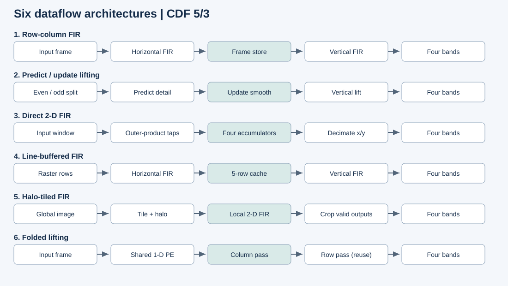
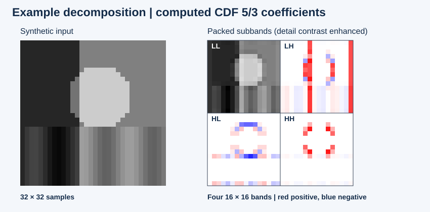

# 2-D DWT architectures for image decomposition

A comparative software reference for six hardware-oriented implementations of the separable two-dimensional discrete wavelet transform (2-D DWT). Identical CDF 5/3 floating-point arithmetic and periodic boundaries isolate the effects of scheduling and dataflow. These are architecture models, not RTL or measured FPGA implementations.





## Architecture comparison

| Method | Arithmetic | Dataflow | Principal trade-off |
|---|---|---|---|
| fir | 5/3 FIR | Row-column, full intermediate | Simple baseline; frame storage |
| lifting | Predict/update | Row-column, vector stages | Lower arithmetic cost |
| direct2d | Outer-product FIR | Four independent 2-D filters | Parallelism at higher arithmetic cost |
| line | Separable FIR | Five cached horizontal rows | Reduced intermediate storage |
| tile | Outer-product FIR | Local tile and global halo | Locality, duplicated halo work |
| folded | Lifting | Serial shared 1-D worker, column-first | Resource reuse versus throughput |

The six are representative design choices, not a citation-count ranking. A real implementation may combine lifting, line buffering, tiling and folding. The direct and tiled variants intentionally share arithmetic, not scheduling. Line buffering assumes random-access periodic input; a strict raster-only device needs a boundary prologue/epilogue or external storage.

## Quick start

Python 3.10+:
```sh
python -m pip install -r requirements.txt
python python/test_dwt.py
python python/demo.py --levels 3
python python/demo.py --image path/to/image.png --levels 2
```

MATLAB (base MATLAB; no Wavelet Toolbox required):
```matlab
addpath('matlab')
test_all
demo([],3)
demo('path/to/image.png',2)
```

The demos crop dimensions to multiples of 2^levels and convert images to grayscale. Outputs include comparison images, coefficient error, reconstruction RMSE and median software runtime (three repetitions). MATLAB and Python image conversion differ for RGB inputs; use the same grayscale array for cross-language equivalence. Timings are not hardware throughput estimates.

## Theory and conventions

For input x, split even e[n]=x[2n] and odd o[n]=x[2n+1]. Predict d[n]=o[n]-(e[n]+e[n+1])/2; update s[n]=e[n]+(d[n-1]+d[n])/4. The inverse reverses these steps. Indices wrap periodically. No integer rounding or JPEG 2000 boundary conventions are implied. The equivalent low-pass taps at offsets -2 through 2 are [-1/8,1/4,3/4,1/4,-1/8]; the high-pass taps at offsets 0 through 2 are [-1/2,1,-1/2].

Horizontal filtering precedes vertical filtering except in the folded variant, where linear separability permits the opposite order. Band names are vertical then horizontal: LL top-left, LH top-right (vertical edges), HL bottom-left (horizontal edges), HH bottom-right. Recursive decomposition operates on LL only. This normalization preserves a constant in LL; it is not orthonormal, so coefficient energy does not equal image energy.

Read [architecture notes](docs/architecture.md) for dataflow and analytical costs. [Python](python/dwt.py) and [MATLAB](matlab/dwt2_arch.m) expose matching method names.

## Literature

- S. Mallat, “A Theory for Multiresolution Signal Decomposition: The Wavelet Representation,” IEEE TPAMI, 1989.
- I. Daubechies and W. Sweldens, “Factoring Wavelet Transforms into Lifting Steps,” JFAA, 1998.
- M. Vishwanath, R. M. Owens and M. J. Irwin, “VLSI Architectures for the Discrete Wavelet Transform,” IEEE TCAS-II, 1995.
- C.-T. Huang, P.-C. Tseng and L.-G. Chen, “Flipping Structure: An Efficient VLSI Architecture for Lifting-Based Discrete Wavelet Transform,” IEEE TSP, 2004.
- M. E. Angelopoulou et al., “A Comparison of 2-D Discrete Wavelet Transform Computation Schedules on FPGAs,” FPT, 2006.

These references motivate the architectural taxonomy; the code is an educational implementation rather than an exact reproduction of each paper.
