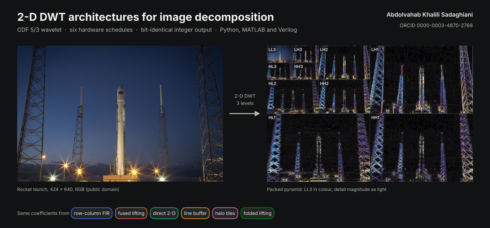

[](https://github.com/VKHS/2D-DWT-architectures-for-Image-decomposition/actions/workflows/ci.yml)
[](https://orcid.org/0000-0003-4870-2768)
[](LICENSE)


**Abdolvahab Khalili Sadaghiani** · ORCID [0000-0003-4870-2768](https://orcid.org/0000-0003-4870-2768) · Department of Electrical Engineering, Linköping University · [authorship](AUTHOR.md) · [citation](CITATION.cff) · [MIT License](LICENSE)

Six hardware schedules of the separable two-dimensional discrete wavelet transform (CDF 5/3 / LeGall 5/3), implemented in Python, MATLAB and parameterised Verilog, with an exact integer contract, a cycle-accurate model of the RTL and a complete illustrated handbook. All six schedules compute the same coefficients; they differ in the order of work, the storage they need and the memory traffic they generate. Those differences are what this repository measures and explains.

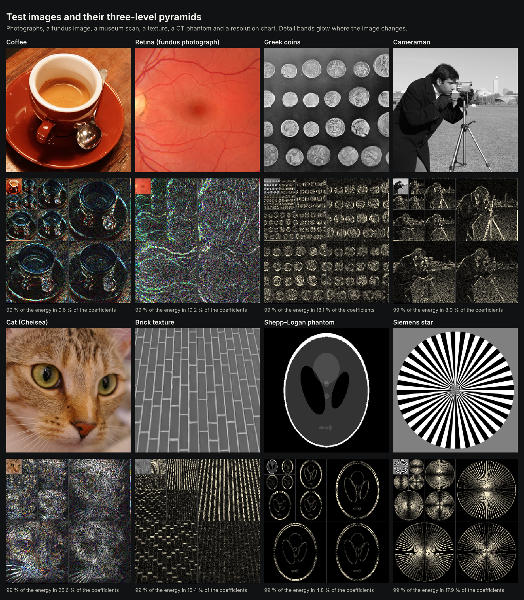

Every image above is split into a quarter-size approximation and three orientations of detail, three times over. Images with large smooth regions concentrate their energy in few coefficients: 99 % of it sits in 4.8 % of the coefficients for the CT phantom, 8.9 % for Cameraman and 9.6 % for Coffee. Fine texture spreads it out: 25.6 % for the cat's fur.

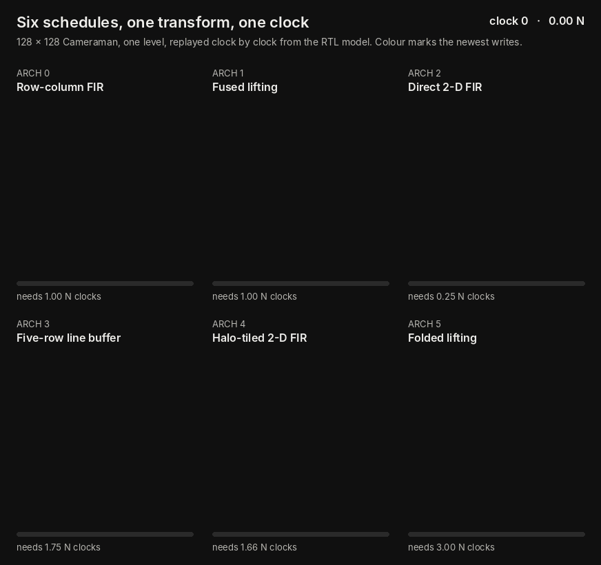

The same 128 × 128 frame passed through all six hardware schedules, replayed clock by clock from the RTL model on one shared clock. The direct 2-D engine finishes at 0.25 *N*, the row-column schedules fill an intermediate frame before writing any coefficient, the tiles appear block by block, and folded lifting takes 3 *N*. Every panel ends with the same bits.

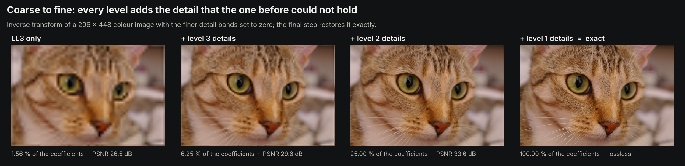

Run backwards, the pyramid rebuilds the image level by level, and the last level restores it exactly.

**At a glance**

- **One transform, six schedules:** row-column FIR, fused lifting, direct 2-D, five-row line buffer, halo-tiled 2-D and folded lifting. In floating point they agree to 1.1 × 10⁻¹⁵; in the RTL's integer arithmetic they are bit-identical.
- **Exact integer contract:** no rounding anywhere. The output port carries 64 × the coefficient, and every band fits a 16-bit signed word (worst case HH = ±32,640).
- **Cycle-accurate RTL model:** [`python/rtl_model.py`](python/rtl_model.py) replays `dwt53_frame.v` clock by clock. It is bit-exact with the integer oracle in 183 frame, architecture and tile runs, and every compute-clock count matches the closed-form schedule.
- **Illustrated throughout:** 16 block diagrams, 15 computed figures and an animation, all from openly licensed or synthetic images and all regenerated from code in this repository.

## Contents

1. [The transform](#1-the-transform)
2. [What the subbands show](#2-what-the-subbands-show)
3. [Why decompose an image](#3-why-decompose-an-image)
4. [Six architectures](#4-six-architectures)
5. [Hardware: interface, controller and fixed point](#5-hardware-interface-controller-and-fixed-point)
6. [Verification](#6-verification)
7. [Quick start](#7-quick-start)
8. [Repository map](#8-repository-map)
9. [References](#9-references)
10. [License and image credits](#10-license-and-image-credits)

## 1. The transform

The CDF 5/3 wavelet splits a signal into a half-rate approximation and a half-rate detail with two short filters whose taps are dyadic fractions, so hardware needs only shifts and adders.

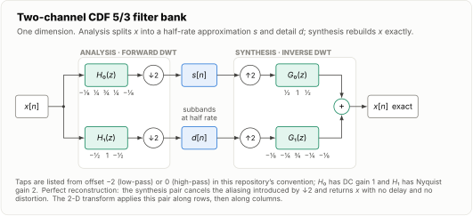

Lifting factors the same filter pair into two in-place steps. For even samples *e*[*n*] = *x*[2*n*] and odd samples *o*[*n*] = *x*[2*n*+1]:

$$
d[n] = o[n] - \tfrac{1}{2}\big(e[n] + e[n+1]\big), \qquad
s[n] = e[n] + \tfrac{1}{4}\big(d[n-1] + d[n]\big).
$$

This is exactly the FIR pair with low-pass taps [−⅛, ¼, ¾, ¼, −⅛] (offsets −2…2) and high-pass taps [−½, 1, −½] (offsets 0…2). The inverse runs the steps backwards with the signs flipped. All indices wrap periodically.

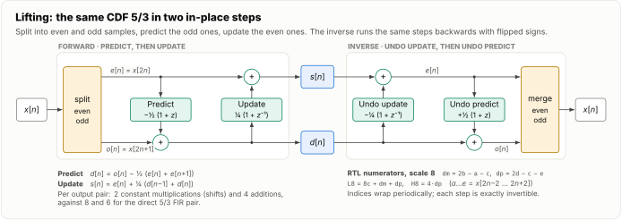

In 2-D, the pair runs along every row and then every column. Band names give the vertical filter first: **LH** is vertical low-pass and horizontal high-pass, so it responds to *vertical edges*. The packed layout used by every implementation is `[LL LH; HL HH]`.

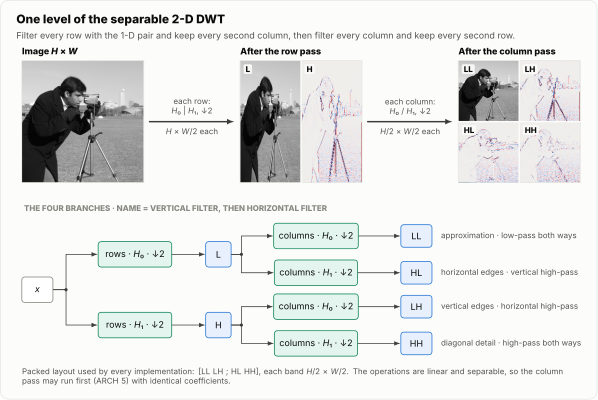

Deeper levels re-decompose LL only. A *J*-level pyramid is an in-place rewrite of one frame buffer and touches fewer than 4*HW*/3 samples in total.

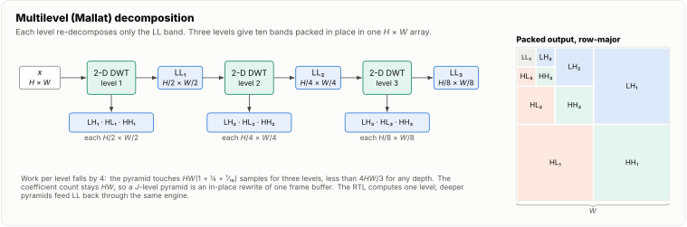

The full derivation is in [docs/theory.md](docs/theory.md): frequency responses, basis functions, perfect reconstruction, normalisation, boundary handling and word-length analysis.

## 2. What the subbands show


*[Example 1](examples/ex01_single_level.py).* LH keeps vertical edges, HL horizontal edges and HH diagonals; LL is a half-resolution image. The orientation test card makes the split unmistakable.


*[Example 2](examples/ex02_multilevel_pyramid.py).* Each level halves LL again: 4, 7, then 10 bands, always *H* × *W* coefficients.


*[Example 3](examples/ex03_zone_plate.py).* On a zone plate, position is frequency, so the decomposition shows directly how the bands tile the 2-D spectrum.

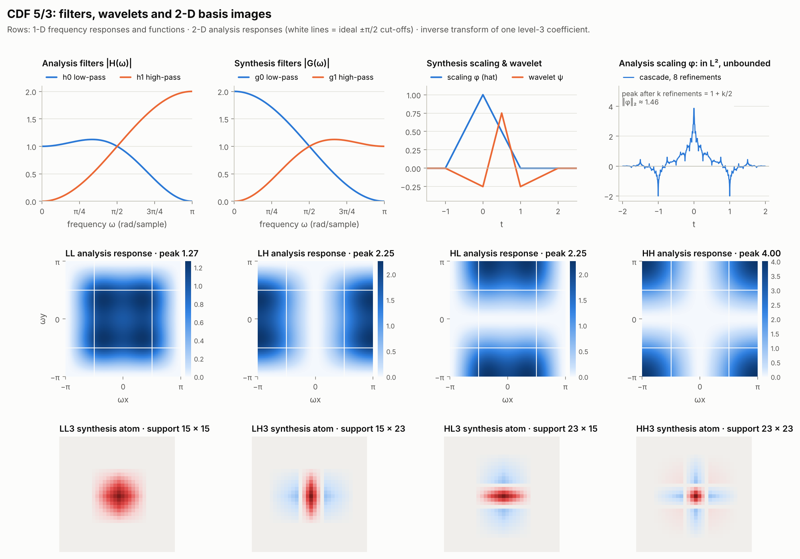

*[Example 4](examples/ex04_filters_and_wavelets.py).* Analysis and synthesis responses, the hat-shaped synthesis scaling function, the irregular (unbounded) analysis scaling function, and the 2-D atoms that an inverse transform assembles images from.

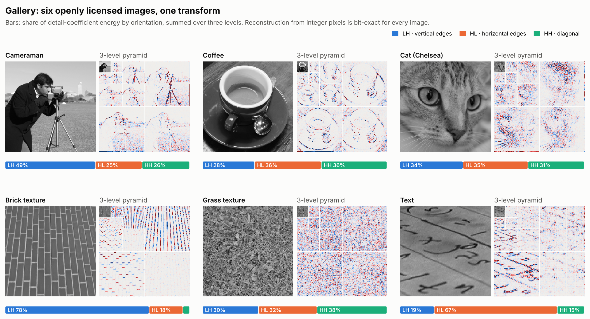

*[Example 5](examples/ex05_gallery.py).* Six openly licensed images. The bars give each image's detail energy by orientation: brick is 78 % LH (vertical mortar joints) and text is 67 % HL (horizontal lines), while grass is nearly isotropic.

## 3. Why decompose an image


*[Example 6](examples/ex06_energy_compaction.py).* After five levels, 7.7 % of the coefficients carry 99 % of the weighted energy. 46 % of the level-1 details lie below one grey level, and their distribution is sharply peaked (kurtosis 18, against 3 for a Gaussian).


*[Example 7](examples/ex07_compression.py).* Keeping 10 %, 3 % or 1 % of the coefficients of Cameraman gives 34.4, 28.5 and 24.3 dB PSNR. Deeper pyramids compact better. This nonlinear approximation is the mechanism behind wavelet image coding.

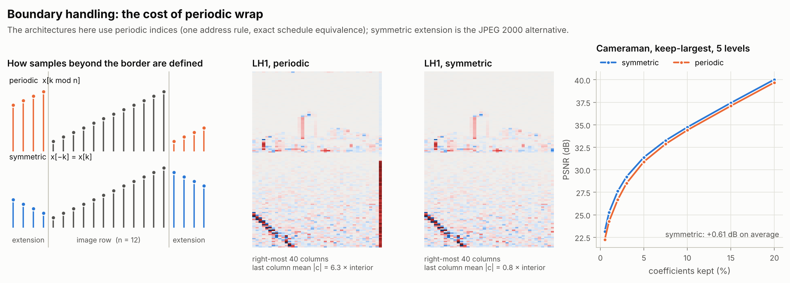

*[Example 8](examples/ex08_boundary.py).* All six architectures use periodic indices: one address rule and exact schedule equivalence. Periodic wrap puts a column of large coefficients at the image border (6.3 × the interior mean). Symmetric extension, the JPEG 2000 rule, removes that column and gains about 0.6 dB in this test.

## 4. Six architectures


| ARCH | Schedule | Compute clocks | Working store (512 × 512) | Frame reads / pixel | Reads / clock | Chapter |
|---:|---|---:|---:|---:|---:|---|
| 0 | Row-column FIR | *N* | 1 MiB (`mid`) | 2.50 | 5 | [arch0](hardware/architectures/arch0.md) |
| 1 | Fused lifting | *N* | 1 MiB (`mid`) | 2.50 | 5 | [arch1](hardware/architectures/arch1.md) |
| 2 | Direct 2-D (outer-product masks) | *N*/4 | none | 6.25 | 25 | [arch2](hardware/architectures/arch2.md) |
| 3 | Five-row line buffer | 7*N*/4 | 10 KiB (`linebuf`) | 6.25 | 5 | [arch3](hardware/architectures/arch3.md) |
| 4 | Halo-tiled direct 2-D, *T* = 8 | 1.66 *N* | 361 B (`patch`) | 1.41 | 25 | [arch4](hardware/architectures/arch4.md) |
| 5 | Folded lifting | 3*N* | 1 MiB (`mid`) | 3.50 | 3 | [arch5](hardware/architectures/arch5.md) |

*N* = *H*·*W*. Clocks are compute clocks between the last input and the first output handshake; reads are logical frame-RAM reads, counted by the RTL model. Tile cost in general: (*N*/4*T*²)((2*T*+3)² + *T*²) clocks.

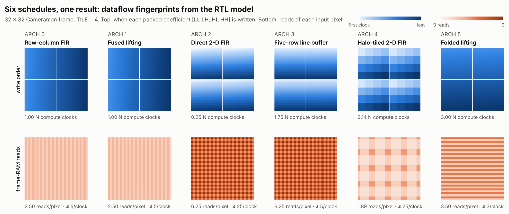

*[Example 9](examples/ex09_rtl_schedules.py)* (the static counterpart of the animation at the top). Top row: when each output coefficient is written. Bottom row: how often each input pixel is read. The line buffer as implemented re-reads exactly like the direct 2-D engine (6.25 reads per pixel), because it refills all five rows for every group. A rotating buffer would bring it close to *N* clocks and 2.5 reads per pixel; [arch3](hardware/architectures/arch3.md) derives this.


*[Example 10](examples/ex10_hardware_costs.py).* Clocks, traffic, port pressure and storage side by side, plus the ARCH 4 tile-size trade-off.

Gate-level schematics of the processing elements: [FIR pair, 7 adders](figures/diagrams/pe_fir.svg) · [fused lifting, 6 adders](figures/diagrams/pe_lifting.svg) · [folded lifting, one predictor over three phases](figures/diagrams/pe_folded.svg) · [direct 2-D, four outer-product masks](figures/diagrams/pe_direct2d.svg). Datapaths: [two-pass separable (ARCH 0, 1, 5)](figures/diagrams/arch_separable.svg) · [line buffer (ARCH 3)](figures/diagrams/arch_line.svg) · [halo tiles (ARCH 4)](figures/diagrams/arch_tile.svg). The [hardware handbook](hardware/README.md) has one chapter per architecture.

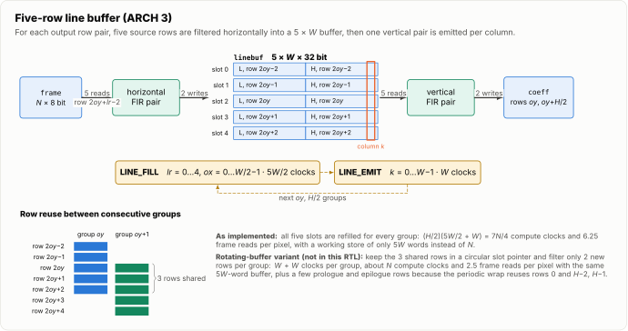

## 5. Hardware: interface, controller and fixed point


[`rtl/dwt53_frame.v`](rtl/dwt53_frame.v) is a frame-buffered, single-level reference with parameters `H`, `W`, `ARCH` and `TILE`. It loads *N* unsigned 8-bit pixels over a ready/valid port, computes with the selected schedule and drains *N* signed coefficients with their packed index.

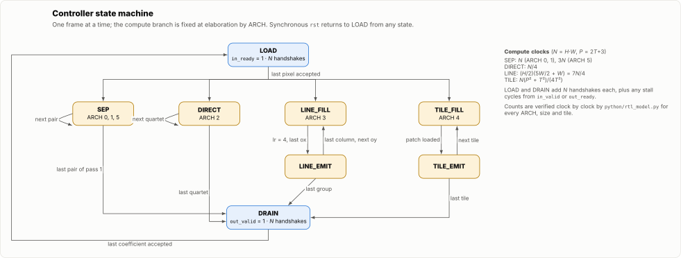


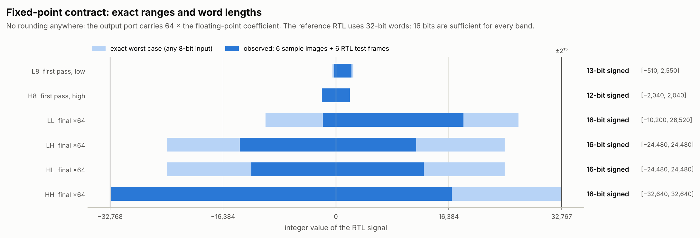

*[Example 11](examples/ex11_fixed_point.py).* First-pass numerators need 13 bits (low) and 12 bits (high); final bands need 16 bits. The worst case is reached, for HH, by the checkerboard test frame.


## 6. Verification

| What | How | Result here |
|---|---|---|
| Six software schedules agree | `python python/test_dwt.py`: random, constant and impulse arrays, 2 × 2 to 64 × 64, 1–3 levels | max deviation ≤ 1 × 10⁻¹² (1.1 × 10⁻¹⁵ on Cameraman 512²) |
| Perfect reconstruction | same test; integer images through 3 levels | float error ≤ 1 × 10⁻¹⁵; integer input reconstructs exactly |
| Integer oracle | [`hardware/golden.py`](hardware/golden.py): independent outer-product Q6 masks against all six software methods | bit-exact on 6 test frames |
| RTL schedules | [`python/rtl_model.py --check`](python/rtl_model.py): clock-by-clock replay of `dwt53_frame.v`, 9 sizes, all ARCH and valid TILE values | 183 runs bit-exact; clock counts equal the formulas |
| RTL simulation | `make test` with Icarus Verilog: six frames per ARCH with input gaps and output stalls, every coefficient, index and `out_last` checked | all six ARCH pass at 8 × 12, 4 × 4 and 16 × 16 in [CI](.github/workflows/ci.yml); simulated compute clocks equal the RTL model |
| MATLAB | `test_all` under Octave | passes in [CI](.github/workflows/ci.yml) |

Software runtimes for a 512 × 512 image, three levels (Python 3.13, NumPy 2.5; median of 5): lifting 4.1 ms, FIR 16 ms, direct 2-D 25 ms, folded 41 ms, line 111 ms, tile 352 ms. These are interpreter timings of reference code, not hardware throughput.

## 7. Quick start

```sh
python -m pip install -r requirements.txt        # numpy, matplotlib, Pillow, scikit-image
python python/test_dwt.py                        # six schedules, reconstruction
python python/rtl_model.py --check               # cycle-accurate RTL model sweep
python python/demo.py --image path/to/image.png --levels 3
make figures                                     # all computed figures (examples/*.py)
make diagrams                                    # all block diagrams (needs XeLaTeX)
make test                                        # software + RTL regression (needs Icarus Verilog)
```

```python
import sys; sys.path.insert(0, "python")
from dwt import decompose, reconstruct
c = decompose(image, levels=3, method="lifting")   # or fir, direct2d, line, tile, folded
x = reconstruct(c, levels=3)
```

MATLAB or Octave (no toolbox needed):

```matlab
addpath('matlab'); test_all
c = dwt2_arch(double(img), 'lifting', 3);  x = idwt2_arch(c, 3);
```

RTL for one architecture, then Vivado synthesis for a chosen part:

```sh
make test H=16 W=16 TILE=4
vivado -mode batch -source scripts/synth_vivado.tcl -tclargs <part> <ARCH> 16 16 4 5.0
```

Your own benchmark images, including classic test images you hold locally, go through [`python/classic_benchmarks.py`](python/classic_benchmarks.py); see [examples/README.md](examples/README.md).

## 8. Repository map

| Path | Contents |
|---|---|
| [`python/dwt.py`](python/dwt.py) | Six schedules, multilevel decomposition and reconstruction |
| [`python/rtl_model.py`](python/rtl_model.py) | Cycle-accurate, bit-true model of the RTL |
| [`python/analysis_tools.py`](python/analysis_tools.py) | Subband weights, keep-largest approximation, symmetric-extension variant |
| [`python/figstyle.py`](python/figstyle.py) | Shared figure style |
| [`examples/`](examples/README.md) | Eleven runnable examples, one per computed figure |
| [`matlab/`](matlab) | `dwt2_arch`, `idwt2_arch`, `test_all`, `demo` |
| [`rtl/`](rtl), [`tb/`](tb) | Verilog top with six schedules, pair cells, self-checking testbench |
| [`hardware/`](hardware/README.md) | Handbook: datapath, six chapters, performance, verification, worked example |
| [`docs/`](docs) | [Theory](docs/theory.md) and [architecture cost model](docs/architecture.md) |
| [`figures/diagrams/`](figures/diagrams) | Block diagrams (SVG) and their TikZ sources |
| [`figures/examples/`](figures/examples) | Computed figures (PNG) and the schedule animation (GIF) |
| [`LICENSE`](LICENSE), [`CITATION.cff`](CITATION.cff), [`AUTHOR.md`](AUTHOR.md) | MIT License, citation metadata, authorship |

## 9. References

1. D. Le Gall and A. Tabatabai, "Sub-band coding of digital images using symmetric short kernel filters and arithmetic coding techniques," *Proc. IEEE ICASSP*, pp. 761–764, 1988.
2. A. Cohen, I. Daubechies and J.-C. Feauveau, "Biorthogonal bases of compactly supported wavelets," *Comm. Pure Appl. Math.*, vol. 45, no. 5, pp. 485–560, 1992.
3. S. Mallat, "A theory for multiresolution signal decomposition: the wavelet representation," *IEEE Trans. Pattern Anal. Mach. Intell.*, vol. 11, no. 7, pp. 674–693, 1989.
4. W. Sweldens, "The lifting scheme: a custom-design construction of biorthogonal wavelets," *Appl. Comput. Harmon. Anal.*, vol. 3, no. 2, pp. 186–200, 1996.
5. I. Daubechies and W. Sweldens, "Factoring wavelet transforms into lifting steps," *J. Fourier Anal. Appl.*, vol. 4, no. 3, pp. 247–269, 1998.
6. M. Vishwanath, R. M. Owens and M. J. Irwin, "VLSI architectures for the discrete wavelet transform," *IEEE Trans. Circuits Syst. II*, vol. 42, no. 5, pp. 305–316, 1995.
7. C. Chakrabarti, M. Vishwanath and R. M. Owens, "Architectures for wavelet transforms: a survey," *J. VLSI Signal Process.*, vol. 14, no. 2, pp. 171–192, 1996.
8. C. Chrysafis and A. Ortega, "Line-based, reduced memory, wavelet image compression," *IEEE Trans. Image Process.*, vol. 9, no. 3, pp. 378–389, 2000.
9. K. Andra, C. Chakrabarti and T. Acharya, "A VLSI architecture for lifting-based forward and inverse wavelet transform," *IEEE Trans. Signal Process.*, vol. 50, no. 4, pp. 966–977, 2002.
10. C.-T. Huang, P.-C. Tseng and L.-G. Chen, "Flipping structure: an efficient VLSI architecture for lifting-based discrete wavelet transform," *IEEE Trans. Signal Process.*, vol. 52, no. 4, pp. 1080–1089, 2004.
11. M. Angelopoulou, K. Masselos, P. Cheung and Y. Andreopoulos, "A comparison of 2-D discrete wavelet transform computation schedules on FPGAs," *Proc. IEEE Int. Conf. Field Programmable Technology (FPT)*, 2006.
12. M. E. Angelopoulou, P. Y. K. Cheung, K. Masselos and Y. Andreopoulos, "Implementation and comparison of the 5/3 lifting 2D discrete wavelet transform computation schedules on FPGAs," *J. Signal Process. Syst.*, vol. 51, pp. 3–21, 2008.
13. D. Taubman and M. Marcellin, *JPEG2000: Image Compression Fundamentals, Standards and Practice*, Kluwer, 2002.

The six schedules follow the row-column, lifting, direct, line-based and block-based families of this literature. The code implements them from the equations above rather than reproducing any single paper's design.

## 10. License and image credits

Code, documentation and figures are released under the [MIT License](LICENSE), © 2026 Abdolvahab Khalili Sadaghiani.

The photographs used in the figures are scikit-image samples and keep their own terms:

| Image | Source | Terms |
|---|---|---|
| Rocket launch | SpaceX | public domain |
| Coffee | Rachel Michetti | CC0 |
| Cat (Chelsea) | Stefan van der Walt | CC0 |
| Cameraman | Lav Varshney | CC0 |
| Retina (fundus photograph) | Wikimedia Commons | CC0 |
| Brick | CC0Textures | CC0 |
| Grass | linolafett (DeviantArt) | CC0 |
| Greek coins | Brooklyn Museum | no known copyright restrictions |
| Text | Wikipedia | public domain |

The orientation test card, zone plate, Shepp–Logan phantom and Siemens star are synthetic and generated by the scripts.
