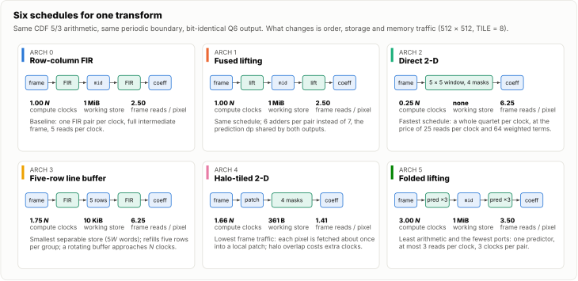
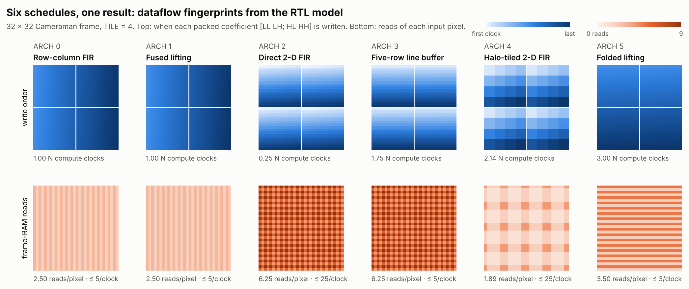
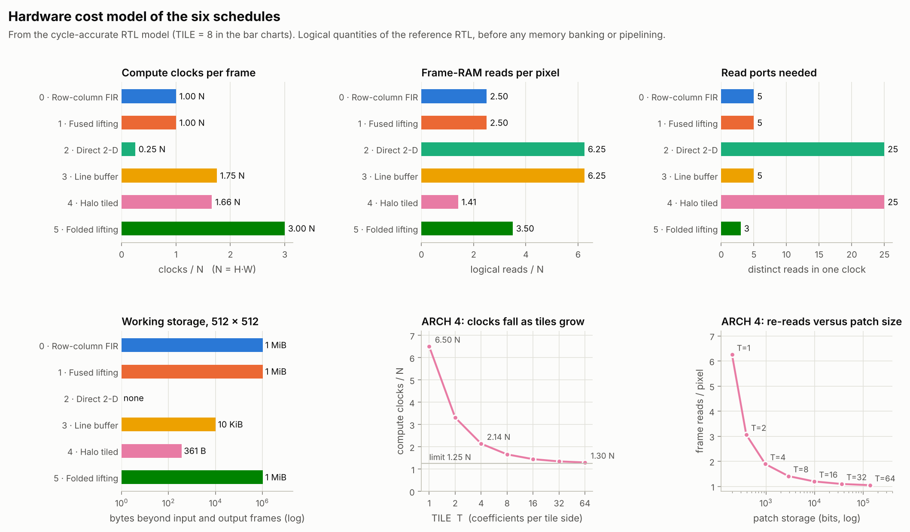

# Architecture cost model

**Author: Abdolvahab Khalili Sadaghiani**

All six schedules compute the same coefficients, so they are compared on what differs: compute clocks, working storage, memory traffic and read-port pressure. Every number below comes from the closed-form schedule and is reproduced clock by clock by the RTL model ([`python/rtl_model.py`](../python/rtl_model.py)).

## Compute clocks

*N* = *H*·*W*, *T* = TILE, *P* = 2*T* + 3. Compute clocks are counted from the clock after the last input handshake to the first `out_valid`. The testbench prints this number.

| ARCH | Schedule | Compute clocks | 256 × 256 | 512 × 512 |
|---:|---|---|---:|---:|
| 0 | Row-column FIR: *N*/2 row pairs + *N*/2 column pairs | *N* | 65,536 | 262,144 |
| 1 | Fused lifting, same order | *N* | 65,536 | 262,144 |
| 2 | Direct 2-D: one quartet per clock | *N*/4 | 16,384 | 65,536 |
| 3 | Line buffer: (*H*/2)(5*W*/2 fill + *W* emit) | 7*N*/4 | 114,688 | 458,752 |
| 4 | Halo tiles: (*N*/4*T*²)(*P*² fill + *T*² emit) | 1.66 *N* at *T* = 8 | 108,800 | 435,200 |
| 5 | Folded lifting: 3 clocks per pair, both passes | 3*N* | 196,608 | 786,432 |

LOAD and DRAIN add *N* handshakes each, plus stall cycles from `in_valid` or `out_ready`; the frame stages do not overlap. A clock count is not a speed: ARCH 2 evaluates 64 weighted terms and 25 reads in one clock, so its achievable clock frequency is the lowest of the six.

## Working storage

Every architecture has the input frame (8*N* bits) and the output store (32*N* bits). Beyond those:

| ARCH | Array | Bits | 512 × 512 |
|---:|---|---|---:|
| 0, 1 | `mid`, full intermediate frame | 32*N* | 1 MiB |
| 2 | none | 0 | — |
| 3 | `linebuf`, five rows | 32 × 5*W* = 160*W* | 10 KiB |
| 4 | `patch`, one halo tile | 8*P*² | 361 B at *T* = 8 |
| 5 | `mid` + two prediction registers | 32*N* + 64 | 1 MiB |

Final coefficients fit 16-bit signed words ([theory §9](theory.md#9-exact-integer-arithmetic-the-rtl-contract)); narrowing `mid` and `coeff` to 13 and 16 bits would cut these figures by 59 % and 50 %.

## Memory traffic and ports

Logical accesses per pixel per frame, counted by the RTL model (distinct addresses per clock):

| ARCH | Frame reads | Working-store reads / writes | Output writes | Distinct reads per clock |
|---:|---:|---|---:|---:|
| 0 | 2.50 | `mid` 2.50 / 1.00 | 1.00 | 5 |
| 1 | 2.50 | `mid` 2.50 / 1.00 | 1.00 | 5 |
| 2 | 6.25 | — | 1.00 | 25 |
| 3 | 6.25 | `linebuf` 2.50 / 2.50 | 1.00 | 5 |
| 4 | 1.41 | `patch` 6.25 / 1.41 | 1.00 | 25 |
| 5 | 3.50 | `mid` 3.50 / 1.00 | 1.00 | 3 |

What the table shows:

- **ARCH 2** reads the full 5 × 5 window for every quartet: neighbouring windows overlap, so each pixel is fetched 6.25 times. 25 distinct reads per clock means replicated or banked memory, or a window register file.
- **ARCH 3** stores only five rows but refills all of them for every output row pair. Each source row is filtered 2.5 times, so the frame traffic equals the direct engine's.
- **ARCH 4** fetches each pixel about once (*P*²/4*T*² = 1.41 at *T* = 8, tending to 1) into a local patch. All re-reads then hit the 361-byte patch, which can sit in registers.
- **ARCH 5** reads 7 samples per pair (3 + 3 + 1) instead of 5, because it recomputes the previous prediction. In exchange it never needs more than 3 reads in one clock, the lowest of the six.

## Tile size (ARCH 4)

| *T* | Compute clocks / *N* | Frame reads / pixel | Patch |
|---:|---:|---:|---:|
| 1 | 6.50 | 6.25 | 200 b |
| 2 | 3.31 | 3.06 | 392 b |
| 4 | 2.14 | 1.89 | 968 b |
| 8 | 1.66 | 1.41 | 2,888 b |
| 16 | 1.45 | 1.20 | 9,800 b |
| 32 | 1.35 | 1.10 | 35,912 b |

Clocks tend to 1.25*N* (*P*² ≈ 4*T*² fill + *T*² emit) and reads tend to one per pixel. Most of the gain is reached by *T* = 8. Overlapping the fill of the next tile with the emission of the current one (double-buffered patches) would hide the fill and approach *N*/4 + fill latency.

## Improvements the measurements point to

| Change | Effect (from the cost model) |
|---|---|
| ARCH 3 rotating buffer: keep the 3 shared rows, filter 2 new rows per group | 7*N*/4 → about *N* clocks (plus a few prologue and epilogue rows for the periodic wrap); 6.25 → about 2.5 frame reads per pixel; same 5*W*-word buffer |
| ARCH 5 carry `dp` forward as the next pair's `dm` | 3 → 2 clocks per pair (about 2*N* per frame, one extra prediction per line for the wrap); 7 → 4 reads per pair |
| ARCH 1 streaming lifting with the same carry | 6 → 4 adders per pair |
| ARCH 2 factorised window (5 vertical pairs + 2 horizontal pairs) | 64 weighted terms → 7 pair evaluations per quartet |
| ARCH 4 double-buffered patch | fill hidden behind emission |
| 16-bit `coeff`, 13-bit `mid` | 50 % / 59 % less working storage |

These are design directions with model-derived numbers; the reference RTL implements the schedules exactly as described in the chapters, and any change should be re-verified with `python/rtl_model.py` and `make test`.

## Mapping to FPGA resources

The reference RTL describes logical arrays with several reads per clock. Synthesis maps them to distributed memory or replicated RAM unless the access pattern is restructured. For BRAM-based designs, bank the intermediate frame (or transpose through two banks), replace modulo indexing with wrap counters, register the adder trees and report post-route clock, LUT, FF, DSP, BRAM, latency and throughput under a common workload. [`scripts/synth_vivado.tcl`](../scripts/synth_vivado.tcl) produces post-synthesis utilisation and timing for any part.
