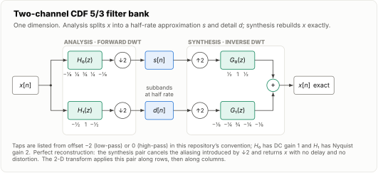
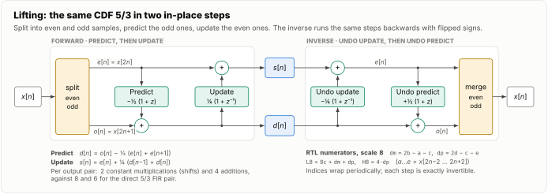
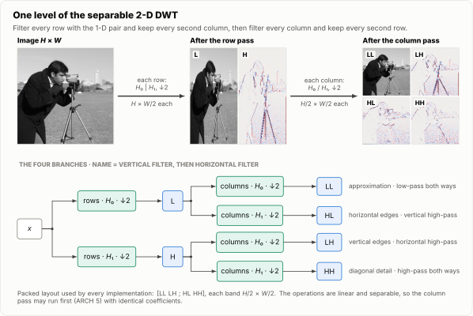
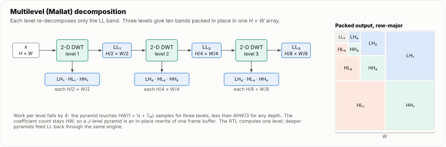

# Theory: the CDF 5/3 wavelet and 2-D image decomposition

**Author: Abdolvahab Khalili Sadaghiani** · ORCID [0000-0003-4870-2768](https://orcid.org/0000-0003-4870-2768)

This chapter derives everything the implementations rely on: the filters, the lifting factorisation, the 2-D separable structure, the frequency-domain picture, the basis functions, normalisation, boundaries and the exact integer arithmetic of the RTL. Each statement is checked by code in this repository; the figure or script that checks it is named next to it.

## 1. The filter pair

For a signal *x*[*n*] of even length, one analysis level produces a half-rate approximation *s* and a half-rate detail *d*:

$$
s[n] = \sum_{k=-2}^{2} h_0[k]\,x[2n+k], \qquad
d[n] = \sum_{k=0}^{2} h_1[k]\,x[2n+k]
$$

| Filter | Taps | Offsets | Gain |
|---|---|---|---|
| analysis low-pass *h*₀ | −⅛, ¼, ¾, ¼, −⅛ | −2 … 2 | 1 at DC, 0 at π |
| analysis high-pass *h*₁ | −½, 1, −½ | 0 … 2 | 0 at DC, 2 at π |
| synthesis low-pass *g*₀ | ½, 1, ½ | centred on even samples | 2 at DC |
| synthesis high-pass *g*₁ | −⅛, −¼, ¾, −¼, −⅛ | centred on odd samples | 1 at π |

The synthesis taps are measured, not assumed: [`examples/ex04_filters_and_wavelets.py`](../examples/ex04_filters_and_wavelets.py) inverts a single coefficient through `python/dwt.py` and asserts them.

With the zero-phase responses (centred on the even sample for the low-pass pair and on the odd sample for the high-pass pair)

$$
H_0(\omega) = 1 + \tfrac{1}{2}\cos\omega - \tfrac{1}{2}\cos^2\omega, \quad
H_1(\omega) = 1 - \cos\omega, \quad
G_0(\omega) = 1 + \cos\omega, \quad
G_1(\omega) = 1 - \tfrac{1}{2}\cos\omega - \tfrac{1}{2}\cos^2\omega ,
$$

perfect reconstruction holds in its two classical parts:

$$
H_0 G_0 + H_1 G_1 = 2 \quad\text{(no distortion)}, \qquad
G_1(\omega) = H_0(\omega+\pi),\; G_0(\omega) = H_1(\omega+\pi) \quad\text{(alias cancellation)}.
$$

Both identities hold to 7 × 10⁻¹⁶ on a 10⁵-point frequency grid. *H*₀ peaks at 9/8 for ω = π/3 and *G*₁ at 9/8 for ω = 2π/3, the slight overshoot visible in [figure 4](../figures/examples/04_filters_and_wavelets.png).

## 2. Lifting

Split into even and odd samples, *e*[*n*] = *x*[2*n*] and *o*[*n*] = *x*[2*n*+1]. Then

$$
\textbf{predict:}\; d[n] = o[n] - \tfrac{1}{2}\big(e[n] + e[n+1]\big), \qquad
\textbf{update:}\; s[n] = e[n] + \tfrac{1}{4}\big(d[n-1] + d[n]\big).
$$

Substituting the predict step into the update step gives back the FIR form:

$$
s[n] = -\tfrac{1}{8}x[2n-2] + \tfrac{1}{4}x[2n-1] + \tfrac{3}{4}x[2n] + \tfrac{1}{4}x[2n+1] - \tfrac{1}{8}x[2n+2].
$$

In polyphase notation the predictor is *P*(*z*) = −½(1 + *z*) and the updater *U*(*z*) = ¼(1 + *z*⁻¹). Each step changes one channel by a function of the other, so it is undone by subtracting the same quantity, in reverse order:

$$
e[n] = s[n] - \tfrac{1}{4}\big(d[n-1] + d[n]\big), \qquad o[n] = d[n] + \tfrac{1}{2}\big(e[n] + e[n+1]\big).
$$

That is why reconstruction is exact for any arithmetic in which the forward and inverse steps compute identical intermediate values.

**Cost per output pair.** Direct FIR: 8 constant multiplications and 6 additions. Lifting: 2 constant multiplications and 4 additions when *d*[*n*−1] is carried from the previous pair. Here every constant is a power of two, so in hardware the multiplications become wiring and only adders remain: 7 in the FIR element, 6 in the fused lifting element ([PE diagrams](../figures/diagrams/pe_fir.svg)).

## 3. Two dimensions

The 2-D transform filters every row, keeps every second column, then filters every column and keeps every second row. Writing **L** = [−1, 2, 6, 2, −1] and **H** = [0, 0, −4, 8, −4] for the numerator taps (offsets −2…2, scale 8 each), the four bands at coefficient position (*i*, *j*) are outer products over a 5 × 5 window centred on (2*i*, 2*j*):

$$
64\,\mathrm{XY}[i,j] = \sum_{k=-2}^{2}\sum_{l=-2}^{2} \mathbf{X}[k]\,\mathbf{Y}[l]\; x[2i+k,\, 2j+l], \qquad \mathbf{X},\mathbf{Y} \in \{\mathbf{L}, \mathbf{H}\}.
$$

The first letter is the vertical filter and the second the horizontal one. **LH** (vertical low, horizontal high) responds to change along a row, that is, to *vertical edges*. **HL** responds to horizontal edges and **HH** to diagonal structure. The masks have 25, 15, 15 and 9 non-zero terms, 64 per output quartet ([masks](../figures/diagrams/pe_direct2d.svg)).

Packed layout (row-major, *H* × *W*):

| Band | Rows | Columns | Address of (*i*, *j*) |
|---|---|---|---|
| LL | 0 … *H*/2−1 | 0 … *W*/2−1 | *iW* + *j* |
| LH | 0 … *H*/2−1 | *W*/2 … *W*−1 | *iW* + *j* + *W*/2 |
| HL | *H*/2 … *H*−1 | 0 … *W*/2−1 | (*i* + *H*/2)*W* + *j* |
| HH | *H*/2 … *H*−1 | *W*/2 … *W*−1 | (*i* + *H*/2)*W* + *j* + *W*/2 |

Because the transform is linear and separable, the column pass may run first (ARCH 5) with identical results. The factorised form of the direct engine (5 vertical pairs, then 2 horizontal pairs per quartet) is the row-column algorithm restricted to one window.

## 4. Multilevel decomposition

Level *j* re-decomposes LL₍ⱼ₋₁₎ in place. A *J*-level pyramid holds 3*J* + 1 bands, still *H* × *W* coefficients, and the work is

$$
HW \sum_{j=0}^{J-1} 4^{-j} < \tfrac{4}{3}\,HW .
$$

Dimensions must be divisible by 2^*J*. The RTL computes one level; the software recurses.

## 5. The frequency-domain picture

Each band is a tile of the 2-D frequency plane: LL keeps |ω_x|, |ω_y| < π/2; LH keeps high horizontal and low vertical frequencies; HL the converse; HH both high. Deeper levels split the LL tile again. The 5/3 filters are short, so the tiles overlap at their borders and decimation folds some energy across them. The zone plate of [example 3](../examples/ex03_zone_plate.py) shows both effects; [example 4](../examples/ex04_filters_and_wavelets.py) plots the 2-D responses, which peak at 1.27 (LL), 2.25 (LH, HL) and 4 (HH).

## 6. Basis functions

Inverting one coefficient through *J* levels samples the corresponding basis function ([example 4](../examples/ex04_filters_and_wavelets.py)):

- **Synthesis scaling function:** the linear B-spline (hat) on [−1, 1].
- **Synthesis wavelet:** piecewise linear on [−1, 2]; values −¼ at 0, ¾ at ½, −¼ at 1.
- **Analysis scaling function:** in *L*² (cascade norm → 1.46) but unbounded. After *k* cascade refinements its peak is 1 + *k*/2. The 5/3 pair buys short integer analysis filters with irregular analysis functions; the image is rebuilt from the smooth synthesis side.
- **2-D atoms at level 3:** supports 15 × 15 (LL), 15 × 23 (LH), 23 × 15 (HL) and 23 × 23 (HH) pixels.

## 7. Normalisation and fair comparison of coefficients

The transform preserves the mean (DC gain 1 per pass), so LL looks like a reduced image, but it is not orthonormal: coefficient energy is not image energy. The squared norms of the synthesis filters are ‖*g*₀‖² = 3/2 and ‖*g*₁‖² = 23/32. A unit coefficient in each level-1 band therefore rebuilds an image of norm 1.5 (LL₁), 1.038 (LH₁, HL₁) or 0.719 (HH₁); at level 3, LL₃ reaches 5.375.

[`python/analysis_tools.py`](../python/analysis_tools.py) computes these weights for every band. Examples 6 to 8 rank coefficients by |*c*| × weight, the standard way to make magnitudes comparable across bands before thresholding or quantisation.

## 8. Boundaries

Every implementation here uses periodic indices, wrap(*k*, *n*) = ((*k* mod *n*) + *n*) mod *n*. This gives one address rule for all six schedules and exact equivalence between them, so the RTL needs a single `wrap()` unit. The cost is an artificial step where the right border meets the left border, which shows up as a column (or row) of large detail coefficients.

Whole-sample symmetric extension (*x*[−*k*] = *x*[*k*], the JPEG 2000 rule) mirrors the image instead. In lifting form it only changes the edge cases: *e*[*N*/2] = *e*[*N*/2 − 1] and *d*[−1] = *d*[0]. [Example 8](../examples/ex08_boundary.py) measures the difference (6.3× border energy with periodic wrap, about 0.6 dB in keep-largest PSNR). The symmetric variant lives in `analysis_tools.py` for comparison only; the hardware contract stays periodic.

## 9. Exact integer arithmetic (the RTL contract)

For 8-bit pixels *a*…*e* = *x*[2*n*−2 … 2*n*+2], each pass computes integer numerators with no rounding:

$$
L_8 = -a + 2b + 6c + 2d - e, \qquad H_8 = 4\,(2d - c - e),
$$

equivalently, in lifting form, *L*₈ = 8*c* + *d*ₘ + *d*ₚ and *H*₈ = 4*d*ₚ, with *d*ₘ = 2*b* − *a* − *c* and *d*ₚ = 2*d* − *c* − *e*. Two passes give exactly 64 × the floating-point coefficient (Q6).

Exact worst-case ranges follow from the positive and negative tap sums of each mask; every one of them is reached by some 8-bit input (frames of at least 6 × 6):

| Signal | Range | Signed word |
|---|---|---:|
| *L*₈ (pass 1) | −510 … 2,550 | 13 bits |
| *H*₈ (pass 1) | −2,040 … 2,040 | 12 bits |
| LL (×64) | −10,200 … 26,520 | 16 bits |
| LH, HL (×64) | −24,480 … 24,480 | 16 bits |
| HH (×64) | −32,640 … 32,640 | 16 bits |

The coarse bound 255 × 16² = 65,280 would suggest 17 bits; the exact bound shows 16 bits are sufficient. The reference RTL keeps 32-bit words for simplicity ([example 11](../examples/ex11_fixed_point.py)).

**Relation to JPEG 2000.** The JPEG 2000 reversible 5/3 transform rounds inside the lifting steps, *d* = *o* − ⌊(*e* + *e*′)/2⌋ and *s* = *e* + ⌊(*d*′ + *d* + 2)/4⌋. That keeps the word length close to the input, but the transform becomes non-linear. This repository keeps the exact numerators instead: the transform stays linear, every schedule (row-first, column-first, direct 2-D, tiled) produces bit-identical integers, and a decoder divides by 64. The price is 4 extra bits per pass.

## 10. Complexity summary

| Form | Per output pair (1-D) | Per output quartet (2-D) |
|---|---|---|
| FIR, shift-add | 7 adders | 4 pair evaluations = 28 adders |
| Lifting, fused | 6 adders | 24 adders |
| Lifting, streaming (carry *d*[*n*−1]) | 4 adders | 16 adders |
| Direct 2-D masks | — | 64 weighted terms (constants are shift-add networks) |
| Direct 2-D, factorised in the window | — | 7 pair evaluations |

Memory traffic and storage, not arithmetic, separate the six architectures; see [architecture.md](architecture.md) and [figure 10](../figures/examples/10_hardware_costs.png).
