# Examples

**Author: Abdolvahab Khalili Sadaghiani**

Eleven runnable examples, one per computed figure. Each script is self-contained, uses the code in [`python/`](../python), writes its figure to [`figures/examples/`](../figures/examples) and asserts what it shows (equivalence of the six schedules, perfect reconstruction, bit-exact RTL model). Run one with `python examples/ex05_gallery.py`, or all with `make figures`.

| # | Script | Shows | Key result |
|---:|---|---|---|
| 1 | [ex01_single_level.py](ex01_single_level.py) | LL, LH, HL, HH of a photograph and an orientation test card | each detail band isolates one edge orientation |
| 2 | [ex02_multilevel_pyramid.py](ex02_multilevel_pyramid.py) | levels 1–3, README hero | 3*J* + 1 bands, always *H* × *W* coefficients; integer input rebuilds exactly |
| 3 | [ex03_zone_plate.py](ex03_zone_plate.py) | zone plate and the frequency tiling | each band keeps one tile of the spectrum |
| 4 | [ex04_filters_and_wavelets.py](ex04_filters_and_wavelets.py) | responses, scaling functions, 2-D atoms | synthesis φ is the hat; analysis φ is unbounded |
| 5 | [ex05_gallery.py](ex05_gallery.py) | six images, orientation energy | brick 78 % LH, text 67 % HL, grass near-isotropic |
| 6 | [ex06_energy_compaction.py](ex06_energy_compaction.py) | sorted magnitudes, captured energy, histogram | 99 % of weighted energy in 7.7 % of coefficients (5 levels) |
| 7 | [ex07_compression.py](ex07_compression.py) | keep-largest reconstruction | 10 % → 34.4 dB, 3 % → 28.5 dB, 1 % → 24.3 dB |
| 8 | [ex08_boundary.py](ex08_boundary.py) | periodic versus symmetric extension | 6.3× border energy with wrap; symmetric +0.6 dB |
| 9 | [ex09_rtl_schedules.py](ex09_rtl_schedules.py) | write order and pixel re-reads of the six RTL schedules | 2.5 to 6.25 frame reads per pixel, same coefficients |
| 10 | [ex10_hardware_costs.py](ex10_hardware_costs.py) | clocks, traffic, ports, storage, tile sweep | ARCH 4 at *T* = 8: 1.66 *N* clocks, 1.41 reads per pixel, 361 B |
| 11 | [ex11_fixed_point.py](ex11_fixed_point.py) | exact integer ranges | every final band fits 16-bit signed |

## 1. One level: four subbands

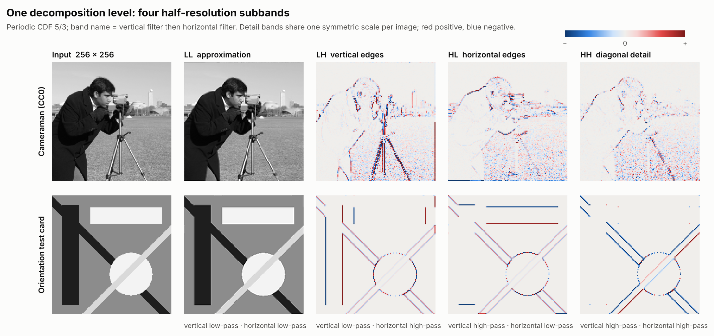

The orientation card contains vertical, horizontal and diagonal bars and a disk. LH lights up on the vertical bar, HL on the horizontal bar, HH on the diagonals; the disk appears in all three with the orientation of its local edge. On Cameraman, the tripod legs appear in LH and HH, the horizon in HL. Detail bands share one symmetric colour scale per row (red positive, blue negative).

## 2. Multilevel pyramid

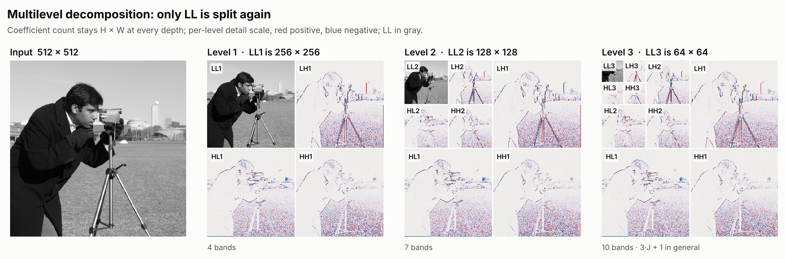

Only LL is split again. The same script writes the README hero image, which runs the forward and inverse transforms on the 8-bit image and reports the maximum reconstruction error (exactly 0).

## 3. Frequency tiling, seen on a zone plate

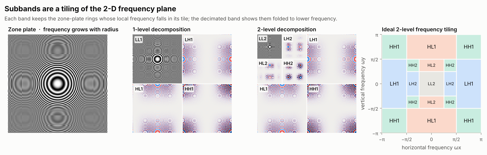

The local frequency of a zone plate grows with radius, so each band shows the rings that fall into its frequency tile. Decimation folds them to lower frequency inside the band, and the short 5/3 filters let some energy cross the ideal tile borders.

## 4. Filters, wavelets and basis images

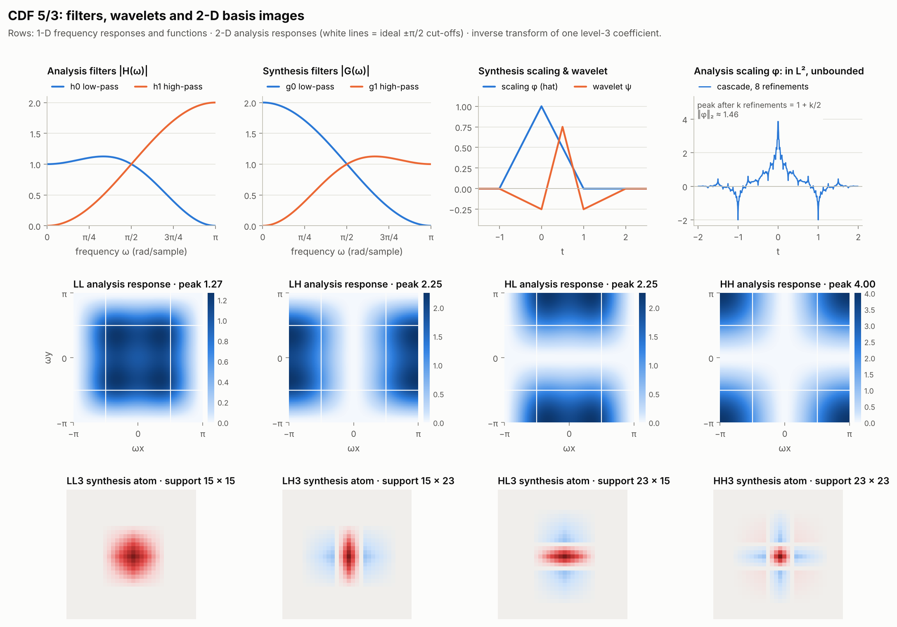

The synthesis taps are measured by inverting single coefficients and asserted against [½, 1, ½] and [−⅛, −¼, ¾, −¼, −⅛]. The 2-D atoms are inverse transforms of one level-3 coefficient per band.

## 5. Gallery

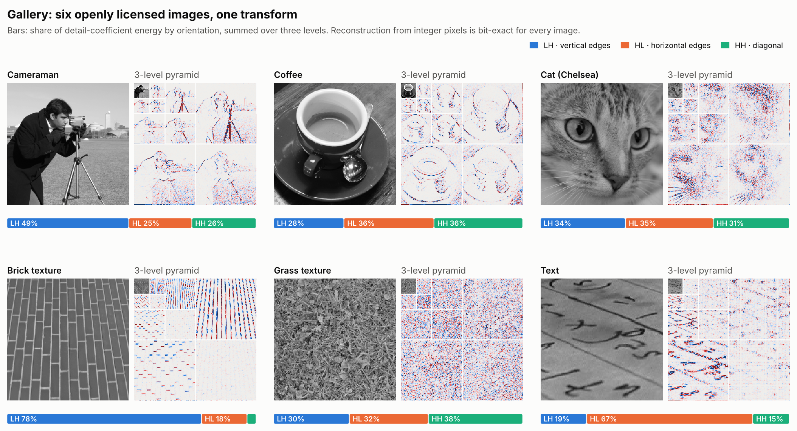

The bars split each image's detail energy (summed over three levels) by orientation. The script also checks that all six schedules give the same pyramid and that the 8-bit image reconstructs exactly.

## 6. Energy compaction

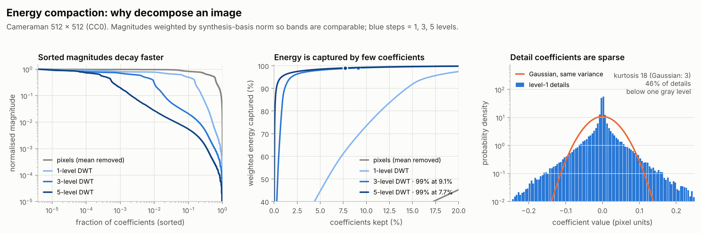

Coefficients are weighted by the norm of their synthesis basis image, because this transform preserves the mean rather than the energy ([theory §7](../docs/theory.md#7-normalisation-and-fair-comparison-of-coefficients)). Detail coefficients have kurtosis 18, against 3 for a Gaussian.

## 7. Keeping only the largest coefficients

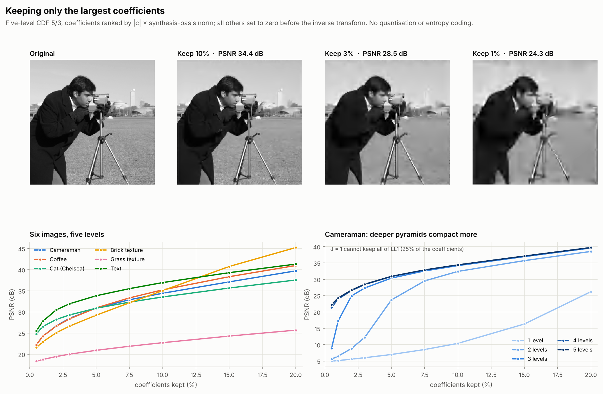

All coefficients except the largest *k* % are zeroed before the inverse transform; no quantisation or entropy coding is involved. With one level, keeping fewer than 25 % of the coefficients must drop part of LL₁, which explains the low curve.

## 8. Boundary handling

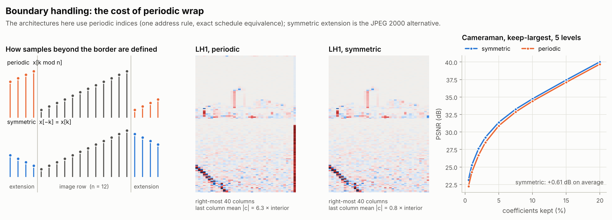

Periodic indices give every architecture one address rule and exact equivalence; symmetric extension removes the border artefact. The symmetric variant in [`python/analysis_tools.py`](../python/analysis_tools.py) is checked against FIR filtering of a reflect-padded signal and for perfect reconstruction.

## 9. Dataflow fingerprints of the RTL schedules

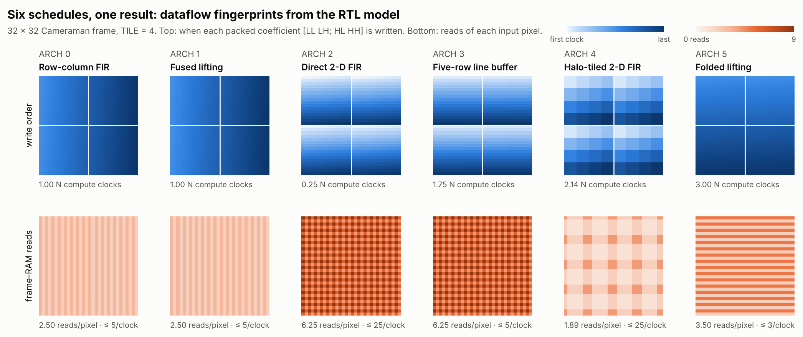

From [`python/rtl_model.py`](../python/rtl_model.py), a clock-by-clock replay of `rtl/dwt53_frame.v`. The row-column schedules write nothing until the second pass; the direct and line engines write row pairs in raster order; tiles fill block by block; the folded schedule writes rows in its second (horizontal) pass. The read maps show the periodic structure of each schedule's re-reads.

## 10. Hardware cost model

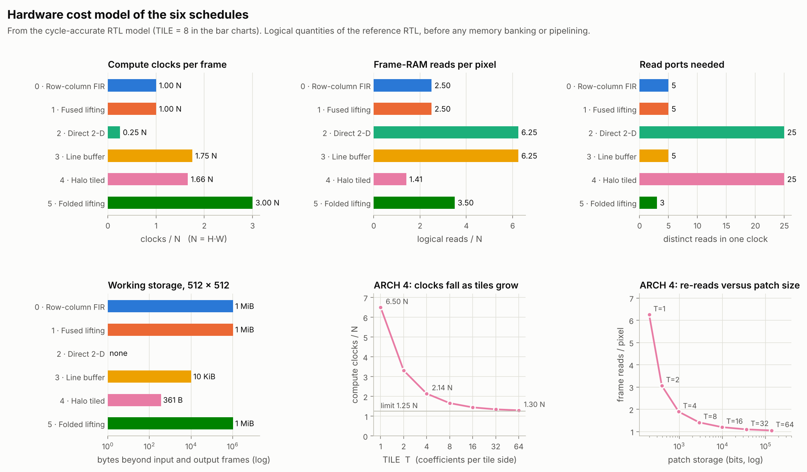

## 11. Fixed-point ranges

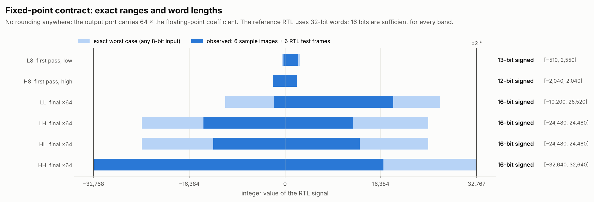

## Your own images and the classic benchmark suite

The preferred classical benchmark suite is **Lena, Barbara, Cameraman, Peppers, Boat, Mandrill and House**. These photographs are not redistributed here; place legally obtained copies in a folder (PNG, JPEG, TIFF, BMP or PGM) and run

```sh
python python/classic_benchmarks.py --directory benchmarks --size 256
```

| Image | Stress case |
|---|---|
| Lena | smooth gradients, edges, fine texture |
| Barbara | periodic fabric textures |
| Cameraman | sharp directional edges |
| Peppers | curves, smooth regions |
| Boat | mixed structural and natural detail |
| Mandrill | dense high-frequency texture |
| House | geometric edges |

For every image the script writes the decomposition figure, `pixels.hex` and the exact Q6 reference `golden_q6.hex`, and adds a row to `manifest.csv` (SHA-256 of the source file, preprocessing, agreement of all six schedules, reconstruction error). To run the RTL on one image:

```sh
make test H=32 W=32 TILE=4 IMAGE=benchmarks/Cameraman.png
```

`python python/gallery.py --image path/to/file.png` produces the same decomposition panels for any single image, and `--natural` adds scikit-image samples. Since 1 April 2024, IEEE no longer accepts new manuscripts that include the Lena image ([IEEE author guidance](https://conferences.ieeeauthorcenter.ieee.org/write-your-paper/improve-your-graphics/)); the openly licensed images used in the figures above are a drop-in alternative for publications.
