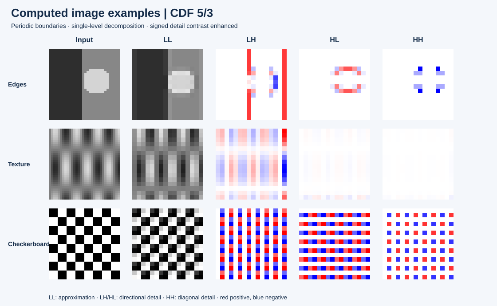

# Image decomposition examples



The gallery above is computed from three original deterministic test patterns using exact CDF 5/3 coefficients. They isolate edges, textures and checkerboard high-frequency content. Gray shows intensities; red/blue shows positive/negative detail coefficients. Detail contrast is enhanced for visibility, not a quantitative energy scale.

For natural image examples, install scikit-image and use its documented benchmark images:

```bash
pip install scikit-image
python python/gallery.py --natural
```

The script evaluates Camera, Astronaut and Chelsea (cat), plus the synthetic examples. Depending on the scikit-image installation, its own data loader may download assets. See https://scikit-image.org/docs/stable/api/skimage.data.html for dataset provenance and licensing. Photographs remain third-party material; they are not attributed to the project author.

To use a locally obtained Lena image or any other image you have permission to use:

```bash
python python/gallery.py --image /path/to/lena.png
make test H=32 W=32 TILE=4 IMAGE=/path/to/lena.png
```

Lena is not redistributed here. It is unsuitable for IEEE submissions under IEEE's Lena image policy. Use the natural alternatives for new publications.

For every image the gallery computes LL/LH/HL/HH with a shared signed detail scale, a three-level pyramid, reconstruction, absolute error and six-method coefficient agreement. The optional hardware vector generator resizes a selected image to H×W, converts it to grayscale and compares all six RTL schedules to the Q6 oracle when a simulator is run. MATLAB supports local images via its existing demo.

## Preferred classical benchmark suite

| Image | Primary stress case |
|---|---|
| Lena | Smooth gradients, edges, fine texture |
| Barbara | Periodic fabric textures |
| Cameraman | Sharp directional edges |
| Peppers | Curves, smooth regions and color-to-gray preprocessing |
| Boat | Mixed structural and natural detail |
| Mandrill | Dense high-frequency texture |
| House | Geometric edges |

Supply legally obtained local files in a directory, using names such as Lena.png, Barbara.png, Cameraman.tif, Peppers.png, Boat.png, Mandrill.png, House.png. The batch script accepts PNG/JPEG/TIFF/BMP/PGM and uses filename stems for labels. It generates software decomposition figures and exact Q6 hardware input/output vectors per image. Run:

```bash
python python/classic_benchmarks.py --directory benchmarks --size 256
```

The output manifest records original file SHA-256, preprocessing, exact software-method agreement, reconstruction error, and coefficient scaling. For image-specific RTL simulation use `make test H=32 W=32 TILE=4 IMAGE=benchmarks/Lena.png` and analogous commands for the other images. Source photographs must be obtained separately; no unverified copies or claims of executed RTL experiments are made.
