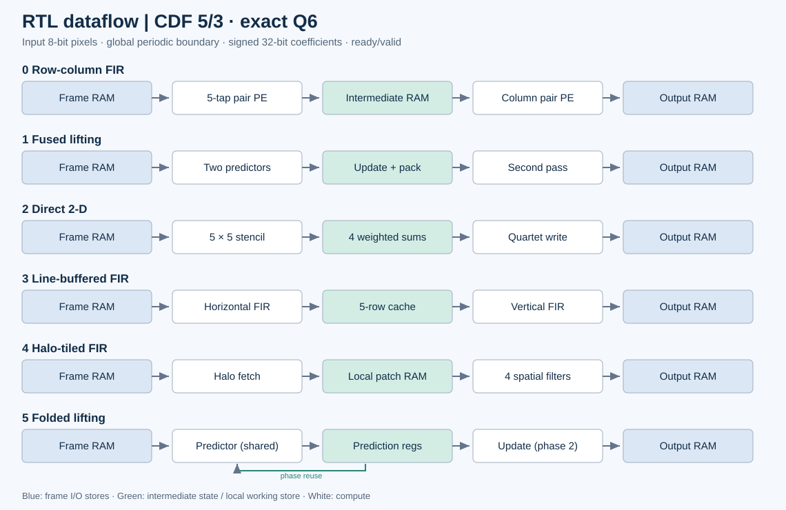
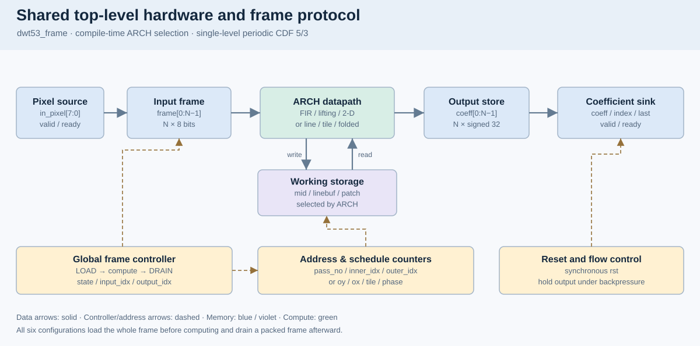

# Hardware architecture and verification

**Project author and maintainer: Abdolvahab Khalili Sadaghiani (VKHS).**

This is a parameterized, single-level Verilog RTL reference, not a claim of FPGA timing closure. Every schedule uses unsigned 8-bit input, signed 32-bit intermediates, periodic boundary conditions and exact scaled coefficients. The input and output are frame-buffered; neither DDR bandwidth nor physical BRAM port conflicts are modeled. No target board, clock, LUT/DSP/BRAM counts or power numbers are assumed.

## Illustrated handbook navigation

| Chapter | Contents |
|---|---|
| [Common datapath](datapath.md) | Arithmetic schematics, signal interface, subband address map, controller FSM |
| [Six architecture chapters](architectures/README.md) | Dedicated hardware schematics, RTL mapping, schedule, memory ports and optimization |
| [Worked example](worked_example.md) | Numerical 4×4 decomposition and controller traces |
| [Performance model](performance.md) | Cycle equations, logical memory footprint, trade-off chart |
| [Verification and deployment](verification.md) | Regression, simulation and Vivado workflow |

## 1. Exact arithmetic contract

For five consecutive samples a,b,c,d,e centered at even c, the low and high numerator equations are

    L8 = -a + 2b + 6c + 2d - e
    H8 = 4(2d - c - e)

where L8 and H8 equal eight times the corresponding floating-point coefficient. Predict/update gives the identical expression with dprev2=2b-a-c and dnext2=2d-c-e; L8=8c+dprev2+dnext2, H8=4dnext2. The RTL uses left shifts and signed arithmetic; there is no truncation, division, saturation or JPEG 2000 reversible integer rounding. The second pass repeats the numerator scaling, hence output C6 = 64*C. For an 8-bit pixel, each 1-D absolute tap sum is at most 16 in numerator units, so a conservative two-pass magnitude bound is 255*16^2=65,280. Signed 17 bits suffice for the final range; 32 bits are deliberately used for reference simplicity. Multilevel floating software support is retained; hardware is single level. Host recursion must preserve the signed coefficient and scale contract; the current 8-bit port does not directly accept LL coefficients.

## 2. Interface

Top: [dwt53_frame.v](../rtl/dwt53_frame.v). Parameters H, W (even, >=2), ARCH (0..5), TILE (positive). ARCH=4 additionally requires H/2 and W/2 divisible by TILE. Clock synchronous active-high reset aborts a frame. Input in_valid && in_ready transfers one unsigned pixel in row-major order; exactly H*W samples define a frame. Computation begins on the next clock, after loading the complete frame. During computation in_ready=0. Output out_valid && out_ready transfers one signed coefficient; out_index is the linear packed row-major index and out_last marks the final coefficient. The output holds stable on backpressure; a new frame is accepted only after the final coefficient transfers. No AXI signal naming/compliance is claimed.

## 3. Six independently scheduled hardware variants

| ARCH | Architecture | Datapath | Controller |
|---:|---|---|---|
| 0 | Row-column FIR | Five-sample window, shift-add low/high | Row pairs then column pairs; full intermediate store |
| 1 | Lifting | Two parallel neighborhood predictors plus update | Row pairs then column pairs; fused combinational lifting |
| 2 | Direct 2-D | Four 5×5 outer-product coefficient sums | One quartet per clock, global periodic address generator |
| 3 | Line-buffered FIR | Five horizontal coefficient rows; vertical pair | Fill five rows then emit one vertical pair per packed column |
| 4 | Halo-tiled FIR | Local (2T+3)² raw-pixel tile and four 2-D sums | Fill halo, emit T² quartets, advance tile |
| 5 | Folded lifting | Phase-controlled predictor and saved prediction registers | Column-first, three clocks per pair; then rows |

ARCH 0 & 1 write two first-pass samples per clock to the intermediate array; the second pass reads five and writes two packed output coefficients. ARCH 1 is a fused predict/update cell, not a register-pipelined lifting graph. ARCH 2 writes LL,LH,HL,HH simultaneously; the outer-product loops describe parallel combinational logic, which may be factored by synthesis. ARCH 3 stores 5W signed words rather than HW intermediate words, but intentionally refills five rows for every output-row group; an optimized circular rotating buffer could retain overlapping rows and reduce recomputation. ARCH 4 copies one input pixel per clock to its patch; boundary wrapping uses global, not tile-local, coordinates. ARCH 5 saves dnext2 and dprev2 across two clocks, emits the pair on the third, and shares the logical predictor between phases. Physical sharing is subject to synthesis and must be inspected.

## 4. Cycle and logical memory model

N=HW, T=TILE, P=2T+3. Count only clocks in the compute state after the final input handshake and before first out_valid; input and output add N clocks each when no stalls. No stage overlap.

| Architecture | Compute clocks (analytical) | Working memory beyond frame and output |
|---|---:|---:|
| FIR | N | N signed words |
| Lifting | N | N signed words |
| Direct 2-D | N/4 | No extra frame store |
| Line | 7N/4 | 5W signed words |
| Tile | (N/(4T²))*(P²+T²) | P² 8-bit pixels |
| Folded | 3N | N signed words + predictor registers |

All variants include N raw pixels and N signed output coefficients; the table counts active logical stores, not inferred physical memories. For a 256×256 image and T=8, the exact formulas imply 65,536, 65,536, 16,384, 114,688, 108,800 and 196,608 compute clocks respectively. Tile calculation: 256 tiles × (361+64)=108,800. The direct path is likely critical-path/port constrained; its smaller cycle count does not mean faster timing. The line implementation trades repeated arithmetic for reduced intermediate capacity. The earlier software line cache can retain overlapping rows; its operation count is not the hardware refill count.

## 5. Simulation and synthesis workflow

    pip install -r requirements.txt
    # Linux: install iverilog using your package manager
    make test
    make test H=16 W=16 TILE=4 IMAGE=/path/to/astronaut.png

The testbench uses 6 frames (zero, max constant, boundary impulse, checkerboard, ramp, seeded random or user image), randomized-pattern deterministic input gaps/output stalls, row-major index checks and exact signed comparison with an independent outer-product integer oracle. It reports compute cycles. The oracle also compares all six Python methods. Simulations should run on Icarus Verilog (2012 testbench syntax; core uses Verilog-2001). The repository includes no fabricated simulator or synthesis logs.

For synthesis in Vivado, add rtl/dwt53_frame.v and rtl/dwt53_pair.v, set dwt53_frame as top, select device and set H/W/ARCH/TILE; use a clock constraint appropriate to your board. The scripts/synth_vivado.tcl example produces utilization and timing estimates for a user-specified part. Post-synthesis estimates are not post-route measurements. The frame stores have multiple asynchronous reads and simultaneous writes; a naive synthesis can map them to distributed registers, mux networks or replicated RAM instead of BRAM. Large H/W are not automatically practical.

### Resource-optimized implementation roadmap

- Bank or replicate memories for two-write and five-read access; transpose or use burst-friendly bank layouts.
- Replace periodic modulo with explicit wrap counters and address generators; add row-level pipeline registers and tag every valid sample.
- Reuse line-buffer halos with five rotating rows, scheduling row ingestion and vertical output concurrently. Define border handling, frame start/end and backpressure explicitly.
- For tiled engines, double-buffer patches and overlap DMA with computation; measure halo overhead.
- Use constrained signed widths and shift-add constants; compare inferred hardware with synthesis reports, not arithmetic counts.
- Add an AXI4-Stream adapter or DMA integration, pipeline across rows/tiles, and verify bit-true equivalence after every change.
- Measure post-route frequency, LUT, FF, DSP, BRAM, throughput, power and reconstruction accuracy under a common workload and board.

### Source map

[RTL frame controller and six schedules](../rtl/dwt53_frame.v) · [Standalone pair cells](../rtl/dwt53_pair.v) · [Scoreboard](../tb/tb_dwt53.v) · [Integer reference](golden.py) · [Makefile](../Makefile).

The standalone cells expose FIR/lifting arithmetic for independent study; the frame top uses equivalent inlined functions rather than instantiating these cells. RTL simulation and target-device synthesis remain to be executed if simulator or FPGA tools are not available.
