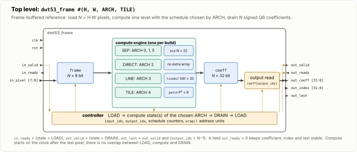
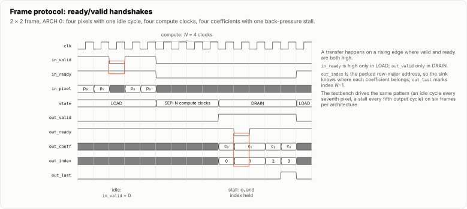

# Hardware handbook

**Author: Abdolvahab Khalili Sadaghiani**

[`rtl/dwt53_frame.v`](../rtl/dwt53_frame.v) is a parameterised, single-level Verilog reference of the 2-D CDF 5/3 DWT with six compute schedules. It loads an *H* × *W* frame of unsigned 8-bit pixels, computes exact signed Q6 coefficients with periodic boundaries, and drains them in packed row-major order. This handbook documents the interface, the arithmetic, every schedule and how all of it is verified.



| Chapter | Contents |
|---|---|
| [Datapath and interface](datapath.md) | arithmetic contract, processing elements, address map, ports, controller |
| [Six architecture chapters](architectures/README.md) | one per ARCH: datapath, RTL mapping, schedule, memory ports, cost, improvements |
| [Worked example](worked_example.md) | a 4 × 4 frame traced through both passes |
| [Performance](performance.md) | clocks, storage, traffic, tile sweep |
| [Verification](verification.md) | oracle, RTL model, simulation, synthesis |
| [Cost model](../docs/architecture.md) | the cross-architecture comparison |

## 1. Parameters and interface

| Parameter | Meaning | Constraint |
|---|---|---|
| `H`, `W` | frame height and width | even, ≥ 2 |
| `ARCH` | schedule, 0…5 | elaboration-time choice; one engine per build |
| `TILE` | coefficient tile side for ARCH 4 | `H/2` and `W/2` divisible by `TILE` |

| Port | Width | Direction | Meaning |
|---|---:|---|---|
| `clk`, `rst` | 1 | in | rising-edge clock, synchronous active-high reset (aborts a frame) |
| `in_valid`, `in_ready` | 1 | in, out | pixel handshake; `in_ready` = (state = LOAD) |
| `in_pixel` | 8 | in | unsigned pixel, row-major |
| `out_valid`, `out_ready` | 1 | out, in | coefficient handshake; `out_valid` = (state = DRAIN) |
| `out_coeff` | 32 | out | signed numerator = 64 × coefficient |
| `out_index` | 32 | out | packed row-major address of `out_coeff` |
| `out_last` | 1 | out | `out_valid` and `out_index` = *N* − 1 |

A transfer happens on a rising edge where valid and ready are both high. Back-pressure (`out_ready` = 0) holds coefficient, index and last stable.



## 2. Arithmetic contract

For five samples *a*…*e* centred on an even position, each pass computes

```
low8  = -a + 2b + 6c + 2d - e          = 8c + dm + dp,   dm = 2b - a - c
high8 = 4 * (2d - c - e)               = 4 * dp,         dp = 2d - c - e
```

with no truncation, division or saturation; two passes give 64 × the floating-point coefficient. First-pass values need 13 bits, final bands 16 bits ([exact ranges](../docs/theory.md#9-exact-integer-arithmetic-the-rtl-contract)); the reference keeps 32-bit words. Multilevel pyramids are computed in software; the RTL computes one level.

## 3. The six schedules


| ARCH | Schedule | Datapath | Controller states | Compute clocks |
|---:|---|---|---|---:|
| 0 | Row-column FIR | [FIR pair element](../figures/diagrams/pe_fir.svg) in the [two-pass datapath](../figures/diagrams/arch_separable.svg) | SEP | *N* |
| 1 | Fused lifting | [lifting element](../figures/diagrams/pe_lifting.svg), same datapath | SEP | *N* |
| 2 | Direct 2-D | [four outer-product masks](../figures/diagrams/pe_direct2d.svg) on a global 5 × 5 window | DIRECT | *N*/4 |
| 3 | Five-row line buffer | [line buffer](../figures/diagrams/arch_line.svg): horizontal pair → 5 × *W* buffer → vertical pair | LINE_FILL, LINE_EMIT | 7*N*/4 |
| 4 | Halo-tiled direct 2-D | [halo tiles](../figures/diagrams/arch_tile.svg): (2*T*+3)² patch → four masks | TILE_FILL, TILE_EMIT | (*N*/4*T*²)(*P*² + *T*²) |
| 5 | Folded lifting | [one predictor over three phases](../figures/diagrams/pe_folded.svg), column pass first | SEP with `phase` | 3*N* |


## 4. Verification in one table

| Level | Tool | Checks |
|---|---|---|
| Arithmetic | [`golden.py`](golden.py) | independent outer-product Q6 masks equal 64 × each of the six software schedules |
| Schedules | [`python/rtl_model.py`](../python/rtl_model.py) | clock-by-clock replay of the RTL states: bit-exact output and closed-form clock counts for 9 sizes, all ARCH, all valid TILE |
| RTL | [`tb/tb_dwt53.v`](../tb/tb_dwt53.v) with Icarus Verilog | six frames per ARCH (zero, full scale, border impulse, checkerboard, ramp, random or your image), input gaps, output stalls, every coefficient, index and `out_last` |
| Synthesis | [`scripts/synth_vivado.tcl`](../scripts/synth_vivado.tcl) | post-synthesis utilisation and timing for any part |

`make test` runs the first and third levels; the [CI workflow](../.github/workflows/ci.yml) runs all software checks, the RTL regression for every ARCH and the MATLAB tests on every push. Details: [verification.md](verification.md).

## 5. From reference to production design

The reference RTL favours clarity: logical arrays with several reads per clock, combinational processing elements, no overlap between frame stages. The [cost model](../docs/architecture.md#improvements-the-measurements-point-to) quantifies the next steps, each to be re-verified with the RTL model and `make test`:

- banked or transposed intermediate memory, wrap counters instead of modulo, registered adder trees;
- a rotating line buffer (about *N* clocks, 2.5 reads per pixel), carried predictions in the folded engine (about 2*N*), a factorised window in the direct engine;
- double-buffered tile patches, 16-bit output and 13-bit intermediate words;
- an AXI4-Stream wrapper and overlap of LOAD, compute and DRAIN across frames.

## Source map

[RTL top with six schedules](../rtl/dwt53_frame.v) · [standalone pair cells](../rtl/dwt53_pair.v) · [testbench](../tb/tb_dwt53.v) · [integer oracle](golden.py) · [RTL model](../python/rtl_model.py) · [Vivado script](../scripts/synth_vivado.tcl) · [Makefile](../Makefile)

The standalone cells `dwt53_fir_pair` and `dwt53_lift_pair` expose the two processing elements for inspection and unit synthesis; the top inlines the same expressions as functions (`lo8`, `hi8`, `pred2`).
