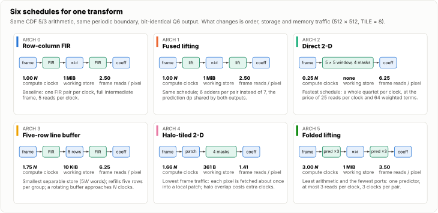

# The six architecture chapters

**Author: Abdolvahab Khalili Sadaghiani**

| ARCH | Chapter | Datapath | Compute clocks | Working store | Frame reads / pixel | Reads / clock |
|---:|---|---|---:|---|---:|---:|
| 0 | [Row-column FIR](arch0.md) | [two-pass](../../figures/diagrams/arch_separable.svg) + [FIR element](../../figures/diagrams/pe_fir.svg) | *N* | 32*N* bits | 2.50 | 5 |
| 1 | [Fused lifting](arch1.md) | [two-pass](../../figures/diagrams/arch_separable.svg) + [lifting element](../../figures/diagrams/pe_lifting.svg) | *N* | 32*N* bits | 2.50 | 5 |
| 2 | [Direct 2-D](arch2.md) | [outer-product masks](../../figures/diagrams/pe_direct2d.svg) | *N*/4 | none | 6.25 | 25 |
| 3 | [Five-row line buffer](arch3.md) | [line buffer](../../figures/diagrams/arch_line.svg) | 7*N*/4 | 160*W* bits | 6.25 | 5 |
| 4 | [Halo-tiled direct 2-D](arch4.md) | [halo tiles](../../figures/diagrams/arch_tile.svg) | (*N*/4*T*²)(*P*² + *T*²) | 8*P*² bits | *P*²/4*T*² | 25 |
| 5 | [Folded lifting](arch5.md) | [two-pass](../../figures/diagrams/arch_separable.svg) + [folded element](../../figures/diagrams/pe_folded.svg) | 3*N* | 32*N* + 64 bits | 3.50 | 3 |

*N* = *H*·*W*, *T* = TILE, *P* = 2*T* + 3. Traffic and port figures are counted by [`python/rtl_model.py`](../../python/rtl_model.py); ARCH 4 is 1.41 reads per pixel at *T* = 8.

[Hardware handbook](../README.md) · [Datapath and interface](../datapath.md) · [Performance](../performance.md) · [Worked example](../worked_example.md) · [Verification](../verification.md)
