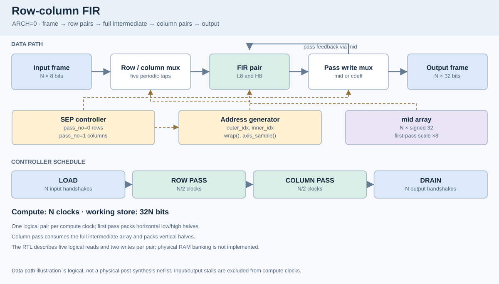
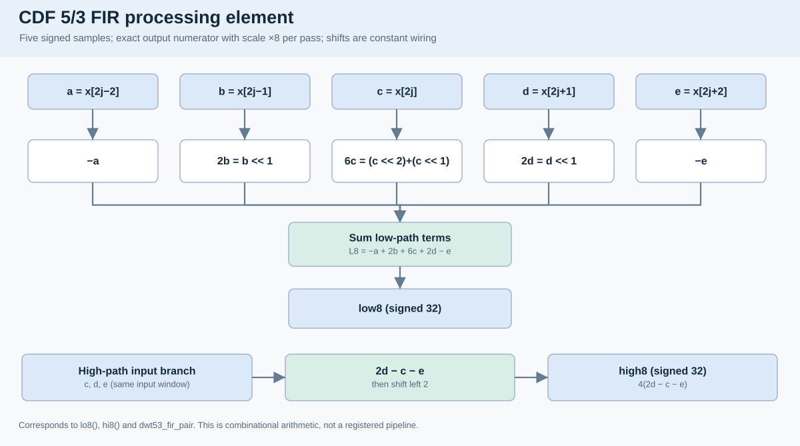
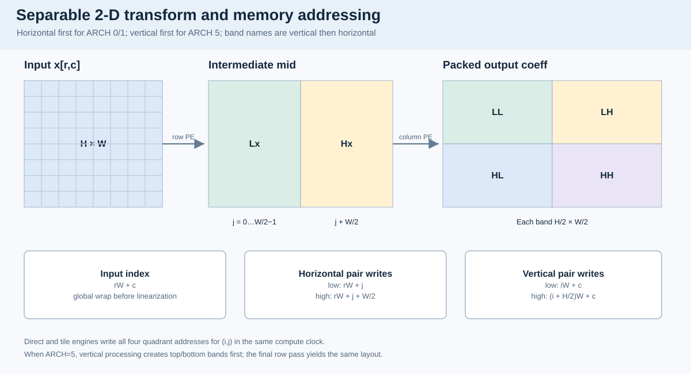

# ARCH 0 — Row-column FIR

**Compute: N clocks · working store: 32N bits** (analytical; excludes frame I/O stalls).

## 1. Dataflow and operating principle

The horizontal pass treats each row as an independent 1-D signal. For pair index j, it reads five globally wrapped source samples at columns 2j−2 through 2j+2. It computes L8 and H8 in parallel and writes them into the left and right halves of mid. After H×W/2 pair writes, pass_no flips to one. In the vertical pass, each packed column of mid is filtered along rows; the low and high outputs go to the top and bottom halves of coeff. The result is LL/LH/HL/HH without a software transpose. The hardware traverses columns through addresses rather than copying a transposed array.

## 2. Processing element and physical organization

## 3. RTL mapping

- SEP executes lo8(sample_k(-2),…,sample_k(2)) and hi8(sample_k(0),sample_k(1),sample_k(2)).
- vertical = (pass_no == 1). axis_sample() selects frame or mid and uses row or column indexing.
- write_pair() sends two results to mid on pass 0 and coeff on pass 1.
- advance_pair() increments inner_idx, then outer_idx, then switches passes or enters DRAIN.

Source: [dwt53_frame.v](../../rtl/dwt53_frame.v); inspect the corresponding controller branch and helper functions. The blocks are logical schematic groupings, not a claim that the top instantiates separate Verilog modules for every block.

## 4. Controller schedule

| Stage | Clocks / handshakes |
|---|---|
| LOAD | N input handshakes |
| ROW PASS | N/2 clocks |
| COLUMN PASS | N/2 clocks |
| DRAIN | N output handshakes |

One logical pair per compute clock; first pass packs horizontal low/high halves.

Column pass consumes the full intermediate array and packs vertical halves.

The RTL describes five logical reads and two writes per pair; physical RAM banking is not implemented.

## 5. Memory ports and implementation cost

Five logical reads and two distinct writes per compute clock. The horizontal neighborhood overlaps the next pair by three positions, but the present RTL uses random-index expressions instead of a shift-register window. Vertical reads have stride W in the original row-major layout. A one-port or two-port block RAM cannot serve all accesses at the assumed issue rate without banking, replication, staged reads or a schedule change.

## 6. Numerical behavior and validation

No intermediate truncation is used. A final signed coefficient is 64 times the floating-point reference. The [worked example](../worked_example.md) gives a numerical input, full packed output, and per-architecture trace. Run `make test` from the repository root to compare this architecture and all other variants against the independent integer oracle. The simulation commands are provided, not evidence of a completed simulation run.

## 7. Production FPGA optimization

A practical implementation uses a five-sample sliding register window, a banked or transposed intermediate layout, and registered FIR stages. If reads and writes are serialized, the N-cycle formula no longer holds. Compare a true dual-bank transpose buffer with a line-based alternative; report achieved rather than assumed II and memory traffic.

[Compare all six architectures](README.md) · [Performance model](../performance.md) · [Hardware handbook](../README.md)
