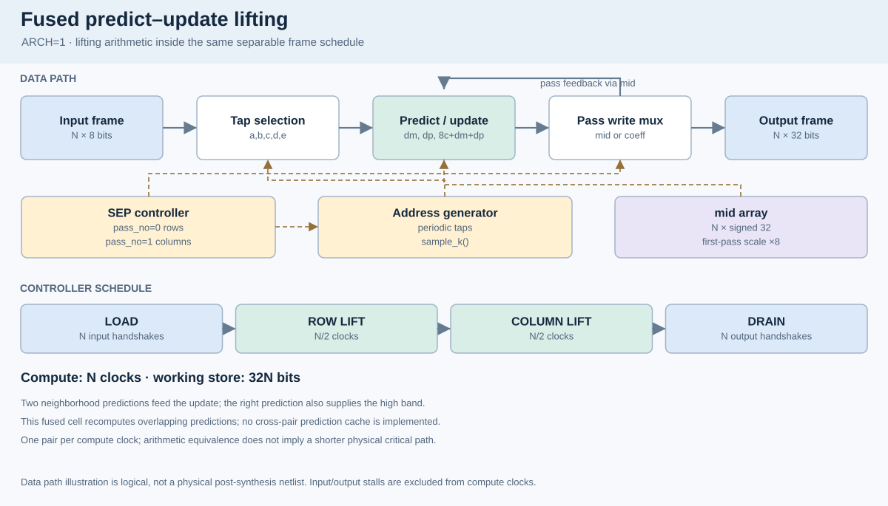
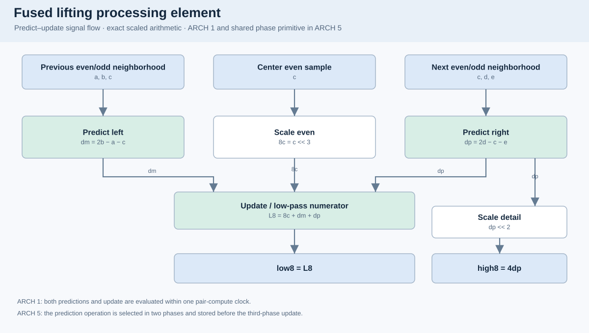
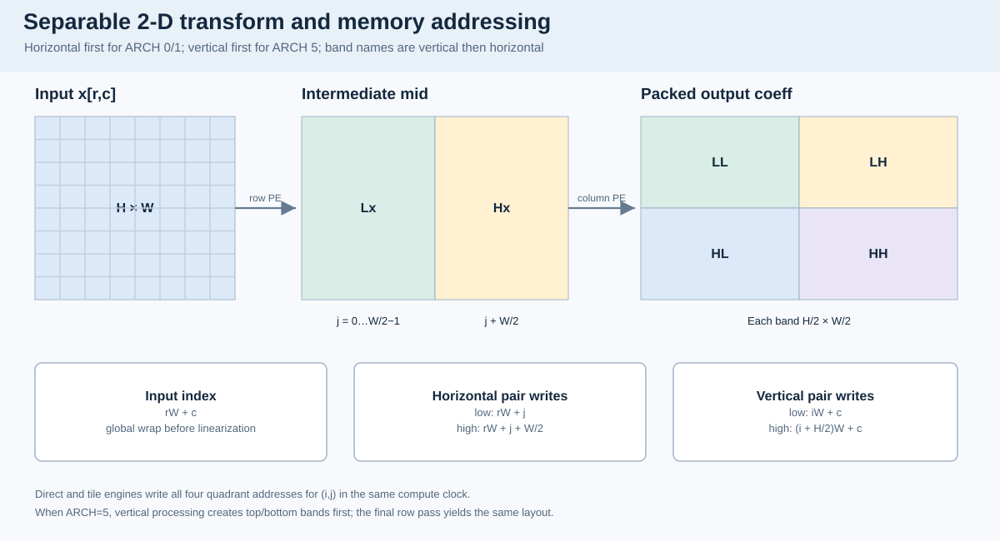

# ARCH 1 — Fused predict–update lifting

**Compute: N clocks · working store: 32N bits** (analytical; excludes frame I/O stalls).

## 1. Dataflow and operating principle

Let a,b,c,d,e be consecutive samples centered at even c. The first prediction dm=2b−a−c represents twice the previous detail; dp=2d−c−e represents twice the current detail. The low path forms 8c+dm+dp, while the high path is 4dp. This is exactly the same FIR numerator without intermediate rounding. Both predictions and update are evaluated during the current pair cycle. As with ARCH 0, the first pass is horizontal and writes mid, the second is vertical and writes coeff.

## 2. Processing element and physical organization

## 3. RTL mapping

- SEP selects the ARCH==1 branch, calls pred2() for the left and right neighborhoods, and calls write_pair().
- The current dp expression appears in both low and high paths; a synthesis tool may eliminate common logic.
- pass_no and axis_sample() control the same row/column memory traversal as ARCH 0.
- The standalone dwt53_lift_pair module provides an inspectable equivalent but is not instantiated by the frame top.

Source: [dwt53_frame.v](../../rtl/dwt53_frame.v); inspect the corresponding controller branch and helper functions. The blocks are logical schematic groupings, not a claim that the top instantiates separate Verilog modules for every block.

## 4. Controller schedule

| Stage | Clocks / handshakes |
|---|---|
| LOAD | N input handshakes |
| ROW LIFT | N/2 clocks |
| COLUMN LIFT | N/2 clocks |
| DRAIN | N output handshakes |

Two neighborhood predictions feed the update; the right prediction also supplies the high band.

This fused cell recomputes overlapping predictions; no cross-pair prediction cache is implemented.

One pair per compute clock; arithmetic equivalence does not imply a shorter physical critical path.

## 5. Memory ports and implementation cost

Like ARCH 0, this requires five logical neighborhood samples and two writes per clock. A true lifting streaming architecture could retain the previous predicted detail between consecutive pair positions. The current fused RTL recomputes both predictions to make each output pair locally self-contained. It does not store a whole detail plane between predict and update.

## 6. Numerical behavior and validation

No intermediate truncation is used. A final signed coefficient is 64 times the floating-point reference. The [worked example](../worked_example.md) gives a numerical input, full packed output, and per-architecture trace. Run `make test` from the repository root to compare this architecture and all other variants against the independent integer oracle. The simulation commands are provided, not evidence of a completed simulation run.

## 7. Production FPGA optimization

Register the predict outputs, align the even center with delayed predictions, and insert a valid tag. Cache the current prediction as the next pair's previous prediction where boundary handling permits. An actual lifting pipeline should be measured against the FIR design with the same numerical precision and buffering.

[Compare all six architectures](README.md) · [Performance model](../performance.md) · [Hardware handbook](../README.md)
