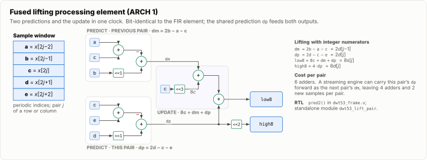

# ARCH 1 — Fused lifting

**Compute: *N* clocks · working store: 32*N* bits · 2.50 frame reads per pixel · 5 reads per clock**



## Principle

Same two-pass schedule and datapath as [ARCH 0](arch0.md), with the [lifting element](../../figures/diagrams/pe_lifting.svg) in place of the FIR element. Within one clock it computes the previous pair's prediction `dm = 2b − a − c`, this pair's prediction `dp = 2d − c − e`, then `low8 = 8c + dm + dp` and `high8 = 4·dp`. The result is bit-identical to the FIR element.

## RTL mapping (state SEP)

```verilog
write_pair((sample_k(0) <<< 3) + pred2(sample_k(-2), sample_k(-1), sample_k(0))
                               + pred2(sample_k(0),  sample_k(1),  sample_k(2)),
           pred2(sample_k(0), sample_k(1), sample_k(2)) <<< 2);
```

## Schedule and memory

Identical to ARCH 0: *N*/2 row pairs then *N*/2 column pairs, 5 reads and 2 writes per clock, full `mid` frame.

## Where it fits and how to improve it

Six adders instead of seven, and the prediction `dp` feeds both outputs. The element recomputes `dm` so that every pair is self-contained. A streaming implementation would carry `dp` forward as the next pair's `dm`: 4 adders and 2 new samples per pair, plus one extra prediction per line for the periodic wrap. Register the predictions, align the even sample with them and tag valid data; then compare against ARCH 0 at the same word lengths and buffering.

[All chapters](README.md) · [Performance](../performance.md) · [Handbook](../README.md)
