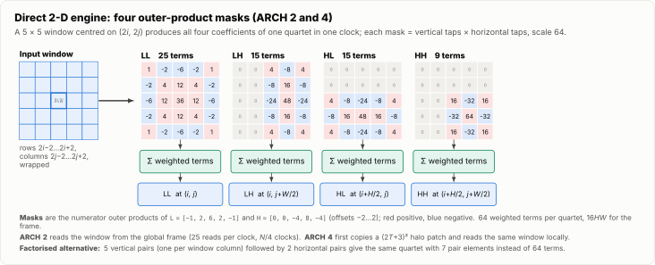

# ARCH 2 — Direct 2-D (outer-product masks)

**Compute: *N*/4 clocks · no intermediate array · 6.25 frame reads per pixel · 25 reads per clock**

## Principle

No intermediate frame at all. For output position (*i*, *j*) the engine reads the 5 × 5 window centred on (2*i*, 2*j*) and evaluates four masks at once: LL, LH, HL and HH, the outer products of the numerator taps **L** = [−1, 2, 6, 2, −1] and **H** = [0, 0, −4, 8, −4]. Each sum is already scaled by 64, and the four results go to the four quadrant addresses in the same clock.

## RTL mapping (state DIRECT)

- `direct_band(r, c, vb, hb, use_patch)` loops over the 5 × 5 window with constant bounds; `weight(band, k)` supplies the taps.
- `emit_direct(oy, ox, 2*oy, 2*ox, 0)` writes `coeff` at (*oy*, *ox*), (*oy*, *ox* + *W*/2), (*oy* + *H*/2, *ox*) and (*oy* + *H*/2, *ox* + *W*/2).
- `ox` advances fastest, then `oy`; the last quartet enters DRAIN.

## Schedule and memory

One quartet per clock, *N*/4 clocks. Each clock reads 25 distinct pixels (fewer on frames smaller than 6 × 6, where wrapped addresses coincide). Neighbouring windows overlap, so every pixel is fetched 6.25 times per frame, the highest frame traffic of the six. The four masks have 25 + 15 + 15 + 9 = 64 non-zero weights.

## Where it fits and how to improve it

The lowest clock count and no intermediate storage, paid for with read bandwidth and a wide combinational reduction that limits the clock frequency. Improvements:

- a shared window register file fed by line storage, so each pixel is read once;
- the factorised window: 5 vertical pairs on the window columns, then 2 horizontal pairs, which gives the same quartet with 7 pair evaluations instead of 64 terms;
- balanced, registered adder trees and independent banks for the four output quadrants.

Compare against the separable engines at equal measured throughput, not equal clock count.

[All chapters](README.md) · [Performance](../performance.md) · [Handbook](../README.md)
