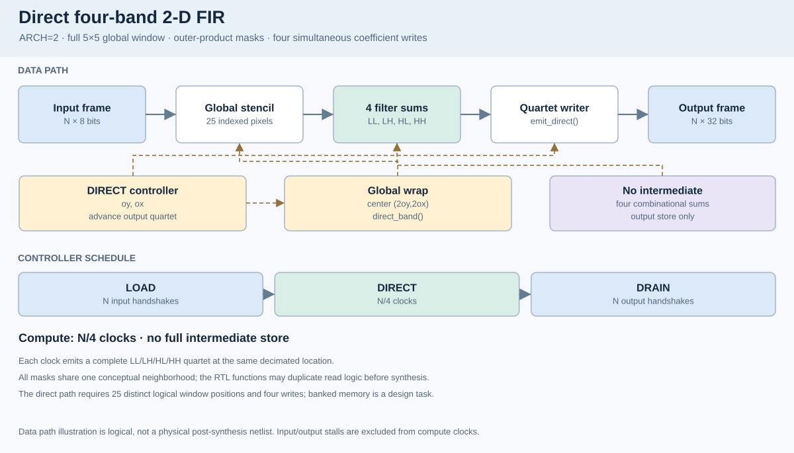
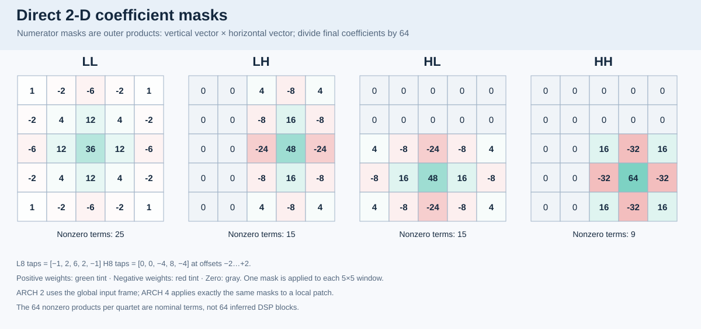
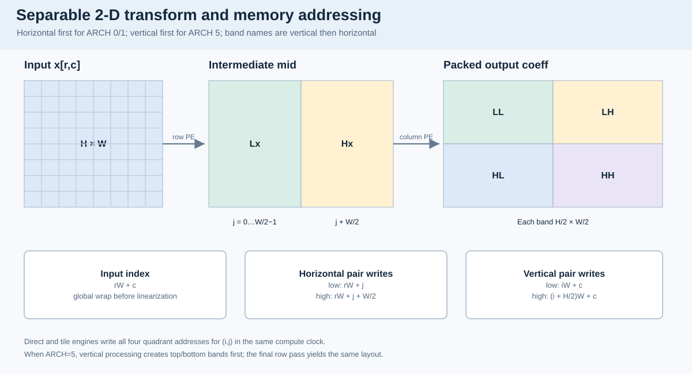

# ARCH 2 — Direct four-band 2-D FIR

**Compute: N/4 clocks · no full intermediate store** (analytical; excludes frame I/O stalls).

## 1. Dataflow and operating principle

Rather than generating a separable intermediate frame, direct_band() evaluates a 5×5 outer product for each output band. Let L=[−1,2,6,2,−1], H=[0,0,−4,8,−4]. At output location (i,j), use a window centered at raw coordinates (2i,2j). The four masks are LᵀL, LᵀH, HᵀL, HᵀH, where the first vector is vertical. Each sum is already scaled by 64. Four coefficients are written in one clock to four quadrant addresses.

## 2. Processing element and physical organization

## 3. RTL mapping

- DIRECT invokes emit_direct(oy,ox,2*oy,2*ox,0).
- direct_band() runs two constant-bound loops over offsets −2…2, reading pix() and multiplying by weight(vb,k)*weight(hb,l).
- emit_direct() writes four non-overlapping quadrant addresses.
- ox advances within a coefficient row, oy advances between rows.

Source: [dwt53_frame.v](../../rtl/dwt53_frame.v); inspect the corresponding controller branch and helper functions. The blocks are logical schematic groupings, not a claim that the top instantiates separate Verilog modules for every block.

## 4. Controller schedule

| Stage | Clocks / handshakes |
|---|---|
| LOAD | N input handshakes |
| DIRECT | N/4 clocks |
| DRAIN | N output handshakes |

Each clock emits a complete LL/LH/HL/HH quartet at the same decimated location.

All masks share one conceptual neighborhood; the RTL functions may duplicate read logic before synthesis.

The direct path requires 25 distinct logical window positions and four writes; banked memory is a design task.

## 5. Memory ports and implementation cost

A quartet has 25 distinct window positions for images at least 6×6 (periodic aliasing may reduce distinct addresses on small frames). The four masks have 25,15,15,9 nonzero terms; naïve evaluation is 64 weighted terms. The RTL repeats function calls for each band and may replicate memory/mux logic. There is no explicit balanced reduction tree, DSP allocation or shared window register bank.

## 6. Numerical behavior and validation

No intermediate truncation is used. A final signed coefficient is 64 times the floating-point reference. The [worked example](../worked_example.md) gives a numerical input, full packed output, and per-architecture trace. Run `make test` from the repository root to compare this architecture and all other variants against the independent integer oracle. The simulation commands are provided, not evidence of a completed simulation run.

## 7. Production FPGA optimization

Use a shared 5×5 window generator backed by line storage, precompute constant-weight shifts, and implement balanced registered reduction trees. Bank the four output subbands independently. Measure routing and fanout, not just nominal multiply counts. Compare against separable engines at equal measured throughput.

[Compare all six architectures](README.md) · [Performance model](../performance.md) · [Hardware handbook](../README.md)
