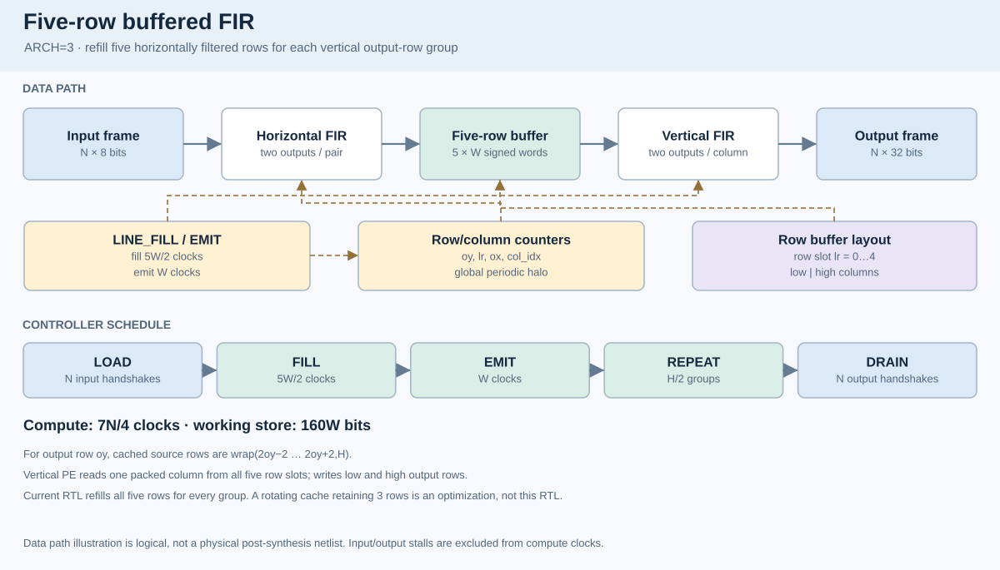
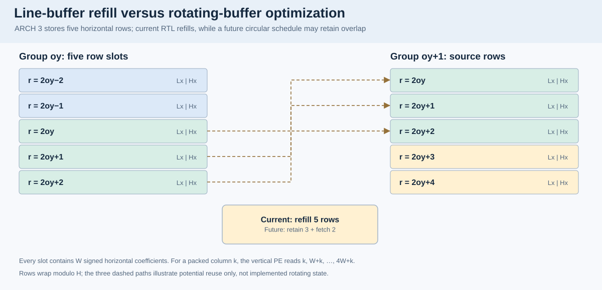
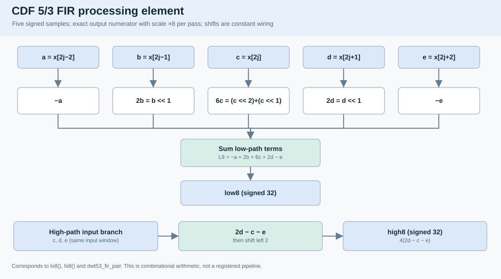

# ARCH 3 — Five-row buffered FIR

**Compute: 7N/4 clocks · working store: 160W bits** (analytical; excludes frame I/O stalls).

## 1. Dataflow and operating principle

For each vertical coefficient row oy, five source rows r=wrap(2oy−2…2oy+2,H) are horizontally filtered. The LINE_FILL state visits slot lr=0…4 and horizontal pair ox=0…W/2−1. It writes low and high coefficients to linebuf[lr*W+ox] and linebuf[lr*W+ox+W/2]. LINE_EMIT then visits each of the W packed columns, reading the five slots and applying vertical low/high equations. It emits two coefficients per clock into output rows oy and oy+H/2. The controller resets lr and col_idx before proceeding to the next oy.

## 2. Processing element and physical organization

## 3. RTL mapping

- LINE_FILL uses pix(), lo8(), hi8(); ox advances fastest, then lr.
- LINE_EMIT uses col_idx and linebuf[lr*W+col_idx] for the vertical pair.
- On the last column of a group, oy increments or state becomes DRAIN.
- The present implementation refills all five slots per group, even though adjacent source neighborhoods overlap.

Source: [dwt53_frame.v](../../rtl/dwt53_frame.v); inspect the corresponding controller branch and helper functions. The blocks are logical schematic groupings, not a claim that the top instantiates separate Verilog modules for every block.

## 4. Controller schedule

| Stage | Clocks / handshakes |
|---|---|
| LOAD | N input handshakes |
| FILL | 5W/2 clocks |
| EMIT | W clocks |
| REPEAT | H/2 groups |
| DRAIN | N output handshakes |

For output row oy, cached source rows are wrap(2oy−2 … 2oy+2,H).

Vertical PE reads one packed column from all five row slots; writes low and high output rows.

Current RTL refills all five rows for every group. A rotating cache retaining 3 rows is an optimization, not this RTL.

## 5. Memory ports and implementation cost

The intermediate footprint is 5W signed words instead of HW; it is smaller only for H>5. The frame and output stores remain. Per fill clock, five raw samples are logically accessed and two packed row coefficients written. Per emit clock, five row-slot values are read and two output coefficients written. A real rotating buffer could assign a separate bank per row and reuse the three overlap rows.

## 6. Numerical behavior and validation

No intermediate truncation is used. A final signed coefficient is 64 times the floating-point reference. The [worked example](../worked_example.md) gives a numerical input, full packed output, and per-architecture trace. Run `make test` from the repository root to compare this architecture and all other variants against the independent integer oracle. The simulation commands are provided, not evidence of a completed simulation run.

## 7. Production FPGA optimization

Keep tags or a modulo slot pointer for the five rows, reuse three overlapping source rows, and load only two new rows per interior output-row group. For a genuinely streaming input, periodic wrap creates dependencies on the end of the image: specify how the first and last row groups are retained or replayed. Double-buffer or schedule horizontal and vertical work with explicit bank and port arbitration.

[Compare all six architectures](README.md) · [Performance model](../performance.md) · [Hardware handbook](../README.md)
