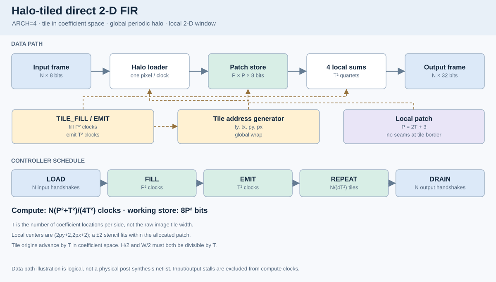
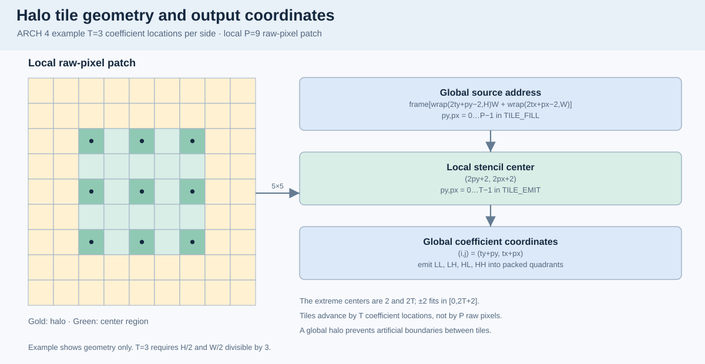

# ARCH 4 — Halo-tiled direct 2-D FIR

**Compute: N(P²+T²)/(4T²) clocks · working store: 8P² bits** (analytical; excludes frame I/O stalls).

## 1. Dataflow and operating principle

A tile has T×T decimated output coordinates, covering T×T coefficients in each of the four bands. It does not mean T×T raw pixels. A 5×5 window at the first raw center requires a two-pixel left/top halo; the last center lies 2(T−1) samples later and requires two pixels on the right/bottom. Therefore the local raw patch spans P=2T+3 positions per axis. TILE_FILL loads the patch with global periodic indexing, one raw pixel per clock. TILE_EMIT evaluates four masks at each local center (2py+2,2px+2) and writes a quartet to global coefficient coordinates (ty+py,tx+px).

## 2. Processing element and physical organization

## 3. RTL mapping

- TILE_FILL writes patch[py*P+px] = pix(2*ty+py−2,2*tx+px−2).
- TILE_EMIT calls emit_direct(ty+py,tx+px,2*py+2,2*px+2,1).
- px/py traverse a patch in fill and a coefficient tile in emit; tx/ty advance by TILE.
- The last tile sends the controller to DRAIN; no partial tiles are supported.

Source: [dwt53_frame.v](../../rtl/dwt53_frame.v); inspect the corresponding controller branch and helper functions. The blocks are logical schematic groupings, not a claim that the top instantiates separate Verilog modules for every block.

## 4. Controller schedule

| Stage | Clocks / handshakes |
|---|---|
| LOAD | N input handshakes |
| FILL | P² clocks |
| EMIT | T² clocks |
| REPEAT | N/(4T²) tiles |
| DRAIN | N output handshakes |

T is the number of coefficient locations per side, not the raw image tile width.

Local centers are (2py+2,2px+2); a ±2 stencil fits within the allocated patch.

Tile origins advance by T in coefficient space. H/2 and W/2 must both be divisible by T.

## 5. Memory ports and implementation cost

Patch storage is 8P² bits. The global frame and coefficient buffers still exist. Neighboring patches overlap by three raw rows or columns in each direction; refetches are deliberate. A patch read must support up to 25 local window positions per quartet clock. The design transfers P² raw pixels per tile before emitting T² quartets.

## 6. Numerical behavior and validation

No intermediate truncation is used. A final signed coefficient is 64 times the floating-point reference. The [worked example](../worked_example.md) gives a numerical input, full packed output, and per-architecture trace. Run `make test` from the repository root to compare this architecture and all other variants against the independent integer oracle. The simulation commands are provided, not evidence of a completed simulation run.

## 7. Production FPGA optimization

Explore ping-pong patch banks to overlap DMA and computation, reuse horizontal/vertical halos, stage a shared local window, and distribute non-overlapping output tiles across independent engines. Larger T reduces halo overhead but raises local storage, mux size and potential routing pressure. Support partial tiles only with explicit boundary masks and additional tests.

[Compare all six architectures](README.md) · [Performance model](../performance.md) · [Hardware handbook](../README.md)
