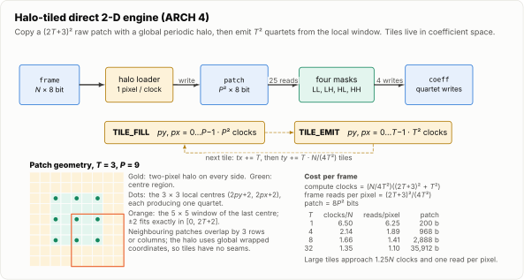

# ARCH 4 — Halo-tiled direct 2-D

**Compute: (*N*/4*T*²)((2*T*+3)² + *T*²) clocks · working store: 8*P*² bits · *P*²/4*T*² frame reads per pixel · 25 reads per clock (from the patch)**

## Principle

A tile is *T* × *T* coefficient positions (not raw pixels) and covers the same positions in all four bands. Its centres sit at raw coordinates 2(*ty* + *py*), 2(*tx* + *px*); the 5 × 5 windows need two extra pixels on every side, so the raw patch spans *P* = 2*T* + 3 pixels per axis. TILE_FILL copies the patch one pixel per clock with global periodic addresses, so tile borders have no seams. TILE_EMIT then evaluates the [four masks](../../figures/diagrams/pe_direct2d.svg) at each local centre (2*py* + 2, 2*px* + 2) and writes the quartet to (*ty* + *py*, *tx* + *px*) and its quadrant copies.

## RTL mapping (states TILE_FILL, TILE_EMIT)

- TILE_FILL: `patch[py*P+px] <= pix(2*ty+py-2, 2*tx+px-2)` over *P* × *P*.
- TILE_EMIT: `emit_direct(ty+py, tx+px, 2*py+2, 2*px+2, 1)` over *T* × *T*.
- `tx` steps by *T*, then `ty`; *H*/2 and *W*/2 must be multiples of *T*.

## Schedule, memory and the tile trade-off

| *T* | Compute clocks / *N* | Frame reads / pixel | Patch |
|---:|---:|---:|---:|
| 1 | 6.50 | 6.25 | 200 b |
| 4 | 2.14 | 1.89 | 968 b |
| 8 | 1.66 | 1.41 | 2,888 b |
| 32 | 1.35 | 1.10 | 35,912 b |

Neighbouring patches overlap by three rows or columns; that overlap is the halo cost, and it vanishes as *T* grows (clocks → 1.25*N*, reads → 1 per pixel). The 25 reads per clock hit the small patch, which can sit in registers, rather than the frame memory. This is the lowest frame traffic of the six ([cost model](../../figures/examples/10_hardware_costs.png)).

## Where it fits and how to improve it

Block-based processing for DMA-fed or cache-based systems. Next steps: ping-pong patches so the fill of tile *k*+1 overlaps the emission of tile *k*, a shared window register stage, several engines on independent tiles, and partial tiles at frame borders (which need explicit masks and their own tests).

[All chapters](README.md) · [Performance](../performance.md) · [Handbook](../README.md)
