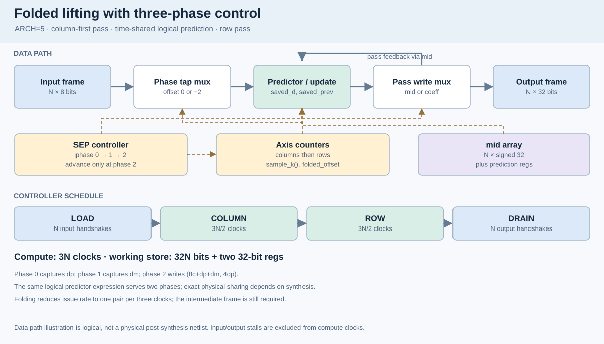
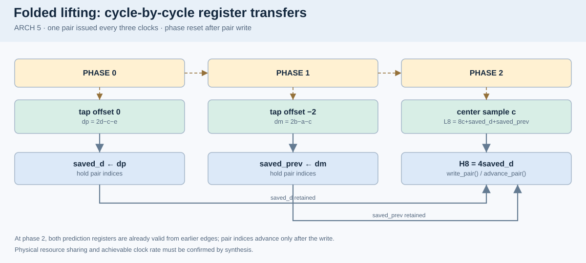

# ARCH 5 — Folded lifting with three-phase control

**Compute: 3N clocks · working store: 32N bits + two 32-bit regs** (analytical; excludes frame I/O stalls).

## 1. Dataflow and operating principle

ARCH 5 uses the separable lifting factorization but serializes the two prediction operations. In phase 0, select offsets (0,1,2) and capture dp into saved_d. In phase 1, select offsets (−2,−1,0) and capture dm into saved_prev. In phase 2, form 8c+saved_d+saved_prev and 4saved_d, call write_pair(), and advance to the next pair. The first pass is vertical, unlike ARCH 0/1. The second pass is horizontal. Because the transform is separable and no intermediate rounding occurs, the output layout and coefficients are unchanged.

## 2. Processing element and physical organization

## 3. RTL mapping

- vertical = (pass_no==0) for ARCH 5.
- folded_offset is 0 in phase 0 and −2 otherwise.
- phase < 2 calls pred2() and writes saved_d or saved_prev.
- phase 2 calls write_pair() and advance_pair(), which resets phase to zero.
- pass 0 writes mid; pass 1 writes coeff.

Source: [dwt53_frame.v](../../rtl/dwt53_frame.v); inspect the corresponding controller branch and helper functions. The blocks are logical schematic groupings, not a claim that the top instantiates separate Verilog modules for every block.

## 4. Controller schedule

| Stage | Clocks / handshakes |
|---|---|
| LOAD | N input handshakes |
| COLUMN | 3N/2 clocks |
| ROW | 3N/2 clocks |
| DRAIN | N output handshakes |

Phase 0 captures dp; phase 1 captures dm; phase 2 writes (8c+dp+dm, 4dp).

The same logical predictor expression serves two phases; exact physical sharing depends on synthesis.

Folding reduces issue rate to one pair per three clocks; the intermediate frame is still required.

## 5. Memory ports and implementation cost

The two prediction clocks each use three logical source samples and one prediction-register write. The final clock uses the center sample plus two prediction registers and writes two coefficients. The full intermediate array remains. Lower per-clock arithmetic demand is possible, but memory structure and the synthesized predictor mux still affect area and timing.

## 6. Numerical behavior and validation

No intermediate truncation is used. A final signed coefficient is 64 times the floating-point reference. The [worked example](../worked_example.md) gives a numerical input, full packed output, and per-architecture trace. Run `make test` from the repository root to compare this architecture and all other variants against the independent integer oracle. The simulation commands are provided, not evidence of a completed simulation run.

## 7. Production FPGA optimization

Instantiate one explicit predictor if tool reports show duplicated arithmetic, then make operand and result multiplexers explicit. Reuse predictions across consecutive positions to reduce redundant work, or select a two-phase schedule. Any revised controller must retain correct phase validity, wrapping, pass transitions, and output ordering.

[Compare all six architectures](README.md) · [Performance model](../performance.md) · [Hardware handbook](../README.md)
