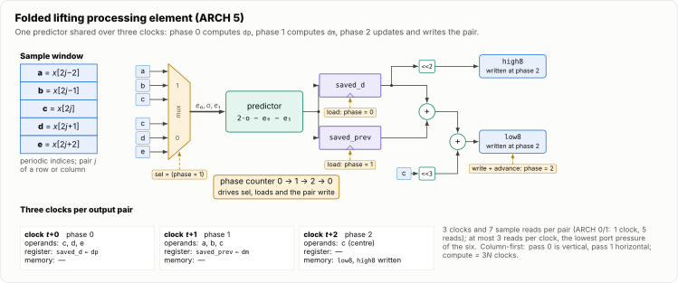

# ARCH 5 — Folded lifting

**Compute: 3*N* clocks · working store: 32*N* + 64 bits · 3.50 frame reads per pixel · 3 reads per clock**

## Principle

The separable lifting factorisation with one shared predictor. Phase 0 selects offsets (0, 1, 2) and stores `dp` in `saved_d`. Phase 1 selects offsets (−2, −1, 0) and stores `dm` in `saved_prev`. Phase 2 forms `low8 = 8c + saved_d + saved_prev` and `high8 = 4·saved_d`, writes the pair and advances. The first pass is vertical and the second horizontal; because the arithmetic is exact, the output is bit-identical to the row-first schedules.

## RTL mapping (state SEP with `phase`)

- `vertical = (ARCH == 5) ? (pass_no == 0) : (pass_no == 1)`.
- `folded_offset = (phase == 0) ? 0 : -2`; phases 0 and 1 call `pred2(sample_k(folded_offset), …)`.
- Phase 2: `write_pair((sample_k(0) <<< 3) + saved_d + saved_prev, saved_d <<< 2)`, then `advance_pair()`.

## Schedule and memory

| Stage | Clocks |
|---|---:|
| pass 0, columns: *N*/2 pairs × 3 | 3*N*/2 |
| pass 1, rows: *N*/2 pairs × 3 | 3*N*/2 |
| total compute | 3*N* |

Per pair: 3 + 3 + 1 = 7 sample reads, never more than 3 in one clock. That is the lowest read-port pressure of the six, at the cost of 3.5 frame reads per pixel and the full `mid` frame.

## Where it fits and how to improve it

The smallest arithmetic footprint: one predictor, one update, two registers. Carrying `dp` forward as the next pair's `dm` removes phase 1 (2 clocks and 4 reads per pair, about 2*N* clocks per frame, plus one extra prediction per line for the wrap). Check the synthesised netlist to confirm that the predictor is shared, and make operand multiplexers explicit if it is not.

[All chapters](README.md) · [Performance](../performance.md) · [Handbook](../README.md)
