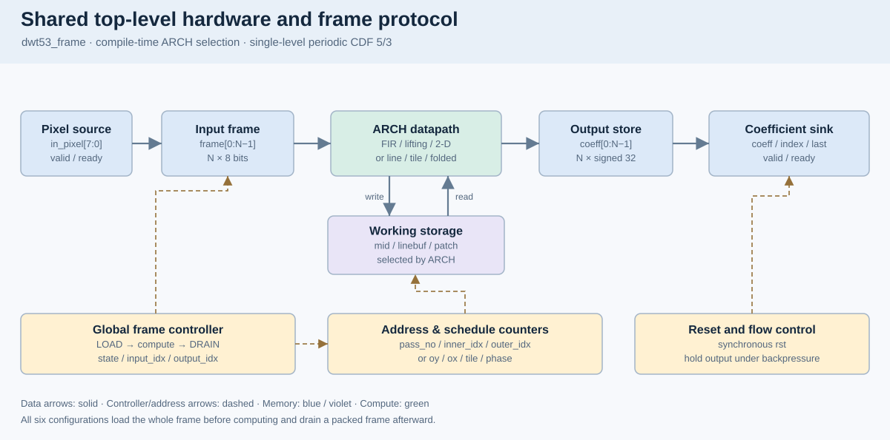
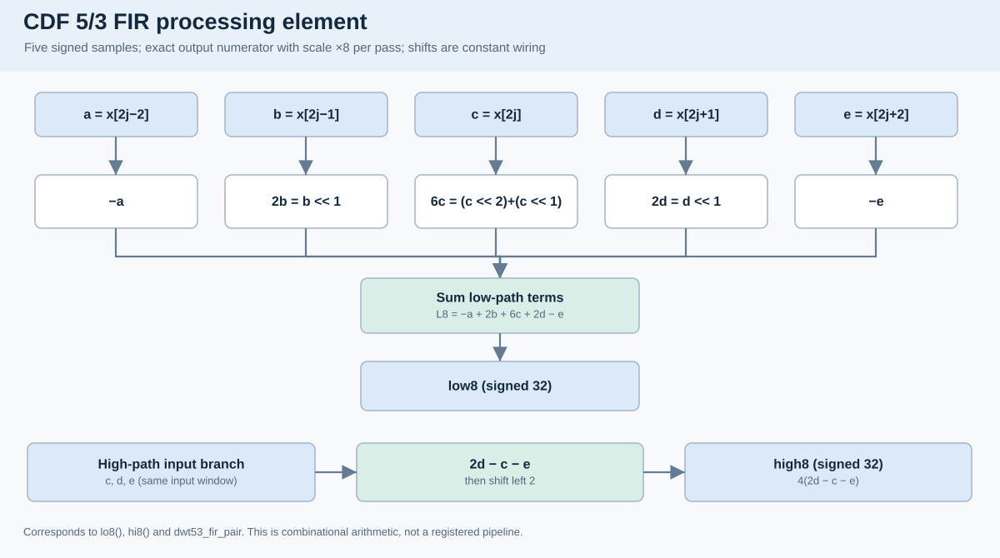
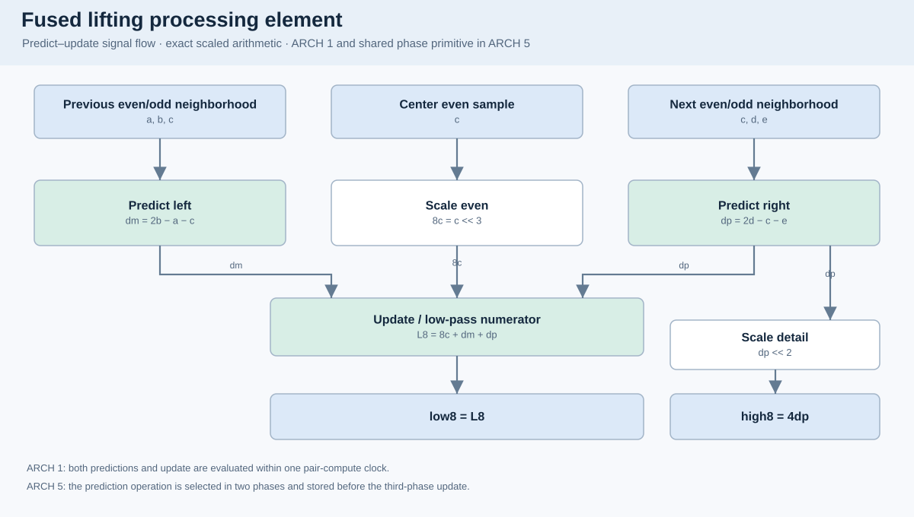
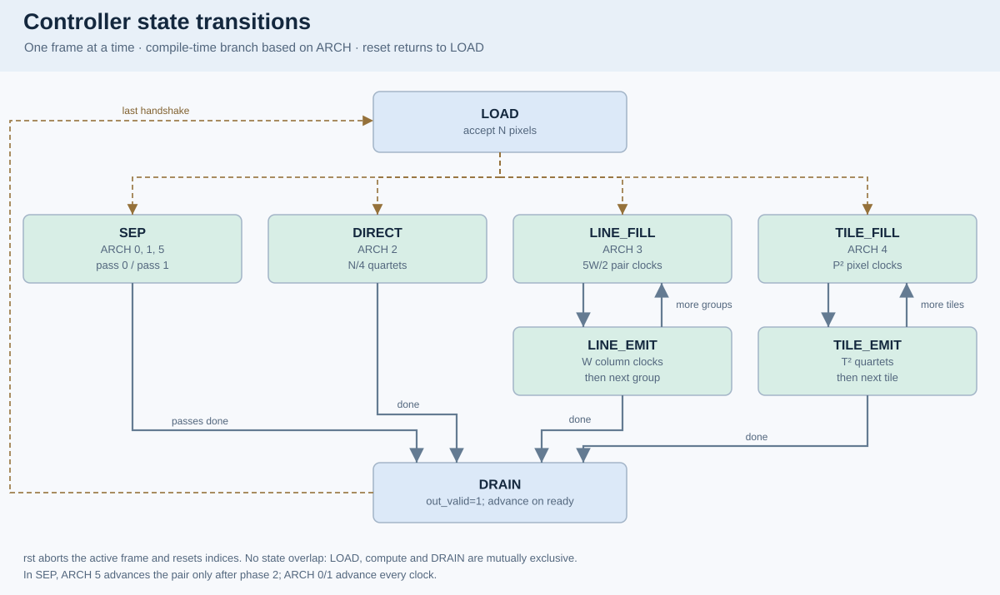

# Common hardware datapath, arithmetic and interface

**Project author and maintainer: Abdolvahab Khalili Sadaghiani (VKHS).**

## Fixed-point representation

The filter is the unrounded, periodically extended CDF 5/3. For each pair, use five consecutive samples centered on an even coordinate. The low numerator is −a+2b+6c+2d−e, and the high numerator is 4(2d−c−e). The first pass has scale 8; the second has scale 64. Right-shifting intermediate values would change the transform and invalidate equivalence with the floating-point software.

The absolute sum of either numerator tap vector is at most 16. For 8-bit unsigned input the conservative intermediate magnitude is 4080 (signed 13 bits), and final magnitude is 65280 (signed 17 bits). The implementation uses signed 32-bit words. In narrowing a design, sign-extend operands before shifts and additions and retain sufficient temporary widths. No arbitrary floating-point conversion is required: interpretation is numerator/64. This is not the rounded JPEG 2000 reversible transform.

## Address generation and packed bands

Each pair uses wrapped offsets −2…+2. For coordinate (i,j) in coefficient space, the four output addresses are iW+j, iW+j+W/2, (i+H/2)W+j and (i+H/2)W+j+W/2. Horizontal and vertical passes commute because arithmetic is exact. At a boundary, wrap(k,n)=((k mod n)+n) mod n; the RTL uses a remainder plus a negative correction. Modulo with constant power-of-two dimensions can simplify; arbitrary dimensions may require additional address logic.

## Controller

At a rising edge, an input is accepted only when in_valid and in_ready are both high. In LOAD, each handshake writes one pixel; input_idx advances only on an accepted pixel. After N input handshakes the compile-time architecture determines the next state. During computation both external transfers are inactive. In DRAIN, each accepted output advances output_idx; a stall keeps the index, coefficient and last indication stable. Reset is synchronous and aborts the frame. No AXI4-Stream wrapper, frame-start signal or concurrent input/output stage is present.

| Port | Width | Interpretation |
|---|---:|---|
| clk, rst | 1 each | Rising-edge clock, active-high synchronous reset |
| in_valid, in_ready | 1 each | Input handshake |
| in_pixel | 8 | Unsigned input |
| out_valid, out_ready | 1 each | Output handshake |
| out_coeff | 32 | Signed numerator, scale 64 |
| out_index | 32 | Packed row-major index |
| out_last | 1 | Final coefficient, qualified by out_valid |

See the [six architecture chapters](architectures/README.md), [worked example](worked_example.md) and [RTL source](../rtl/dwt53_frame.v).
