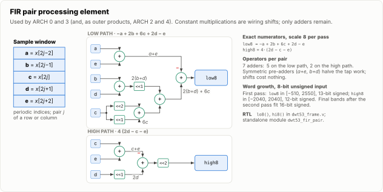
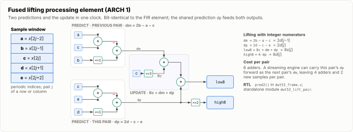
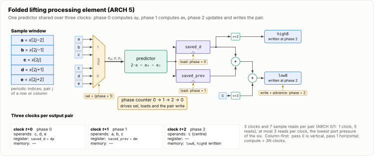
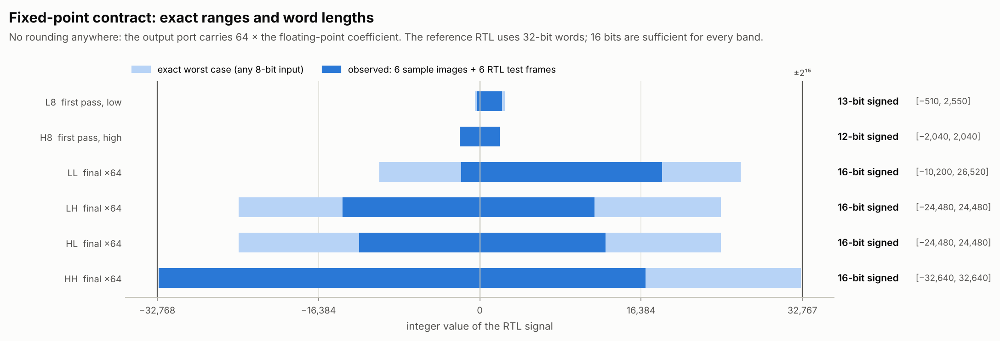
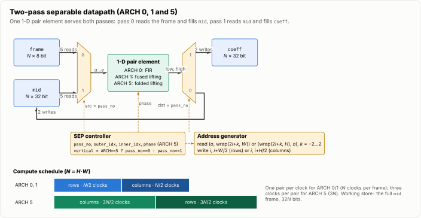
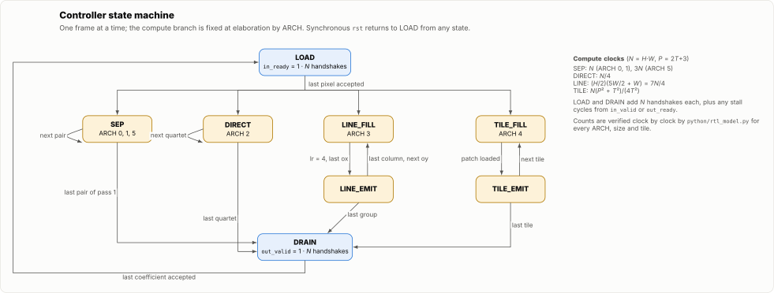

# Datapath, arithmetic and interface

**Author: Abdolvahab Khalili Sadaghiani** · ORCID [0000-0003-4870-2768](https://orcid.org/0000-0003-4870-2768)

## Processing elements

Every schedule is built from one of three processing elements. All take the same five-sample window *a*…*e* = *x*[2*j*−2 … 2*j*+2] (periodic indices) and produce the same two numerators.

The FIR element uses symmetric pre-adders (*a*+*e*, *b*+*d*) and builds 6*c* as 4*c* + 2*c*: 7 adders and no multipliers. RTL: `lo8()`, `hi8()`; standalone module `dwt53_fir_pair`.

The lifting element computes both predictions and the update in one clock: 6 adders, with `dp` shared by both outputs. RTL: `pred2()`; standalone module `dwt53_lift_pair`.

The folded element time-multiplexes one predictor over three phases and holds the two predictions in registers: 3 clocks per pair, at most 3 sample reads per clock.

## Fixed-point representation

The first pass has scale 8, the second scale 64. Right-shifting an intermediate value would change the transform and break equivalence with the floating-point software, so the reference keeps full numerators. Exact ranges for 8-bit input:

| Signal | Range | Signed width |
|---|---|---:|
| `low8` (pass 1) | −510 … 2,550 | 13 |
| `high8` (pass 1) | −2,040 … 2,040 | 12 |
| final LL | −10,200 … 26,520 | 16 |
| final LH, HL | −24,480 … 24,480 | 16 |
| final HH | −32,640 … 32,640 | 16 |

When narrowing words, sign-extend operands before shifts and additions. This is the unrounded 5/3 transform, not the JPEG 2000 reversible (rounded) variant; [theory §9](../docs/theory.md#9-exact-integer-arithmetic-the-rtl-contract) compares the two.

## Address generation and packed bands

Pair *j* of a row or column reads wrapped offsets −2…+2 around 2*j*. The RTL `wrap(k, n)` takes the remainder and adds *n* when it is negative. For power-of-two dimensions this reduces to bit masking; otherwise wrap counters are cheaper than a modulo unit.

Coefficient (*i*, *j*) of each band lives at:

| Band | Address |
|---|---|
| LL | *iW* + *j* |
| LH | *iW* + *j* + *W*/2 |
| HL | (*i* + *H*/2)*W* + *j* |
| HH | (*i* + *H*/2)*W* + *j* + *W*/2 |

Horizontal pair writes go to (*r*, *j*) and (*r*, *j* + *W*/2); vertical pair writes go to (*i*, *c*) and (*i* + *H*/2, *c*). Because the arithmetic is exact, the two passes commute, so ARCH 5 can run the column pass first.

## Controller

In LOAD, each accepted pixel is written to `frame[input_idx]`. After the *N*-th handshake the controller enters the compute state of the chosen ARCH on the next clock; both external handshakes are idle during computation. In DRAIN, each accepted coefficient advances `output_idx`; a stall holds coefficient, index and `out_last`. A new frame starts after the last coefficient transfers. Reset is synchronous and returns to LOAD from any state.

See the [six architecture chapters](architectures/README.md), the [worked example](worked_example.md) and the [RTL source](../rtl/dwt53_frame.v).
