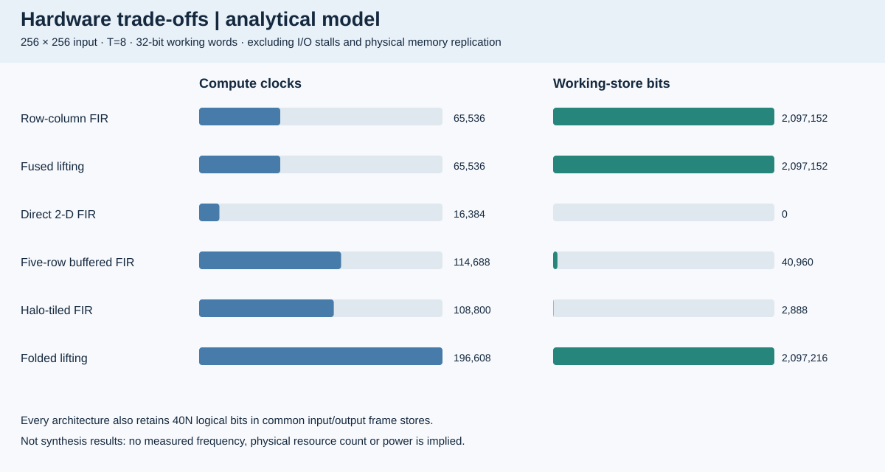

# Analytical hardware cost and design trade-offs

Let N=HW, T=TILE and P=2T+3. The frame buffers total 40N logical bits (8N input + 32N output) for every architecture. The following working-store and latency models are derived from controller states and exclude backpressure, FPGA primitive padding, replication, registers outside the named arrays and routing.

| ARCH | Compute clocks | Total unstalled transfer + compute clocks | Working bits |
|---|---:|---:|---:|
| 0 FIR | N | 3N | 32N |
| 1 lifting | N | 3N | 32N |
| 2 direct | N/4 | 9N/4 | 0 extra array bits |
| 3 line | 7N/4 | 15N/4 | 160W |
| 4 tile | N(P²+T²)/(4T²) | 2N + compute | 8P² |
| 5 folded | 3N | 5N | 32N+64 |

ARCH 3 refill costs (H/2)(5W/2) and vertical emission costs (H/2)W. ARCH 4 requires N/(4T²) tiles and spends P²+T² clocks on each tile. ARCH 5 has two passes, each N/2 pairs, each taking three clocks. There is no pipeline overlap across frames.

For a hypothetical 200 MHz achieved clock, frame throughput would be fclk/(2N+C) under a stall-free interface. This is a conditional formula, not an achieved clock or measurement. For 256×256, T=8, the common I/O buffers are 2,621,440 bits before RAM mapping. A full intermediate adds 2,097,152 bits, a line buffer adds 40,960 bits, and the tile patch adds 2,888 bits. These savings concern intermediate capacity only, not total physical utilization.

## Practical FPGA decisions

- If memory dominates, compare the line and tile variants, but account for frame storage and memory bandwidth.
- If latency dominates, the direct 2-D variant has fewer modeled clocks but potentially expensive combinational reduction, fanout and read ports.
- If arithmetic area dominates, folded lifting is a candidate; physical sharing requires inspecting the synthesized netlist.
- If sustained streaming dominates, a rotating line buffer with registered FIR or lifting is a promising *future* design, not the implemented full-frame RTL.
- Compare hardware at identical image dimensions, arithmetic precision, boundary behavior, output interface and target device. Report post-route clock, latency, II, LUTs, FFs, DSPs, BRAM/URAM, power and image accuracy separately.

The original software arithmetic counts in docs/architecture.md describe ideal filter arithmetic, not the number of operators in a synthesized implementation. In particular, fused lifting recomputes both neighboring predictions; a streaming prediction cache can reduce repeated work. The present line RTL refills all five rows rather than caching overlaps.
