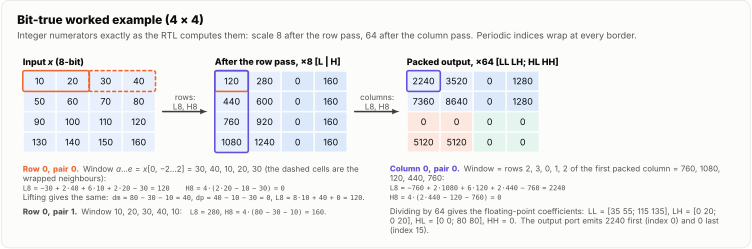

# Bit-true worked example

**Author: Abdolvahab Khalili Sadaghiani** · ORCID [0000-0003-4870-2768](https://orcid.org/0000-0003-4870-2768)

A 4 × 4 frame, small enough to follow every operation. All numbers below are produced by [`hardware/golden.py`](golden.py) and by [`python/rtl_model.py`](../python/rtl_model.py) for every ARCH.



## Input

```
 10   20   30   40
 50   60   70   80
 90  100  110  120
130  140  150  160
```

## Row pass (scale 8)

Row 0, pair 0 is centred on column 0. With periodic wrap the window is *x*[0, −2…2] = 30, 40, 10, 20, 30:

```
L8 = -30 + 2*40 + 6*10 + 2*20 - 30 = 120
H8 = 4 * (2*20 - 10 - 30)          = 0
```

Lifting gives the same values: `dm = 2*40 - 30 - 10 = 40`, `dp = 2*20 - 10 - 30 = 0`, `L8 = 8*10 + 40 + 0 = 120`.

Row 0, pair 1 (window 10, 20, 30, 40, 10): `L8 = -10 + 40 + 180 + 80 - 10 = 280`, `H8 = 4 * (80 - 30 - 10) = 160`.

Packed intermediate `[L | H]`:

```
 120   280     0   160
 440   600     0   160
 760   920     0   160
1080  1240     0   160
```

## Column pass (scale 64)

The first packed column, pair 0, reads rows 2, 3, 0, 1, 2 = 760, 1080, 120, 440, 760:

```
L8 = -760 + 2*1080 + 6*120 + 2*440 - 760 = 2240
H8 = 4 * (2*440 - 120 - 760)             = 0
```

Packed output `[LL LH; HL HH]`, scale 64:

```
2240  3520     0  1280
7360  8640     0  1280
   0     0     0     0
5120  5120     0     0
```

Divided by 64:

```
 35   55    0   20
115  135    0   20
  0    0    0    0
 80   80    0    0
```

The output port emits 2240 first (`out_index` 0) and 0 last (`out_index` 15). Negative coefficients, when present, are two's complement.

## Controller trace for all six schedules

For *N* = 16 and TILE = 1:

| ARCH | Compute clocks | Breakdown |
|---:|---:|---|
| 0 | 16 | 8 row pairs + 8 column pairs |
| 1 | 16 | same order, lifting element |
| 2 | 4 | 4 quartets |
| 3 | 28 | 2 groups × (10 fill + 4 emit) |
| 4 | 104 | 4 tiles × (25 fill + 1 emit) |
| 5 | 48 | 8 column pairs + 8 row pairs, 3 clocks each |

LOAD and DRAIN add 16 handshakes each when nothing stalls. `make test H=4 W=4 TILE=1` simulates this configuration; the testbench drives its own six frames rather than this particular matrix, and the RTL model reproduces the matrix above for every ARCH.
